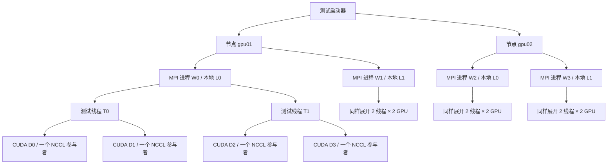
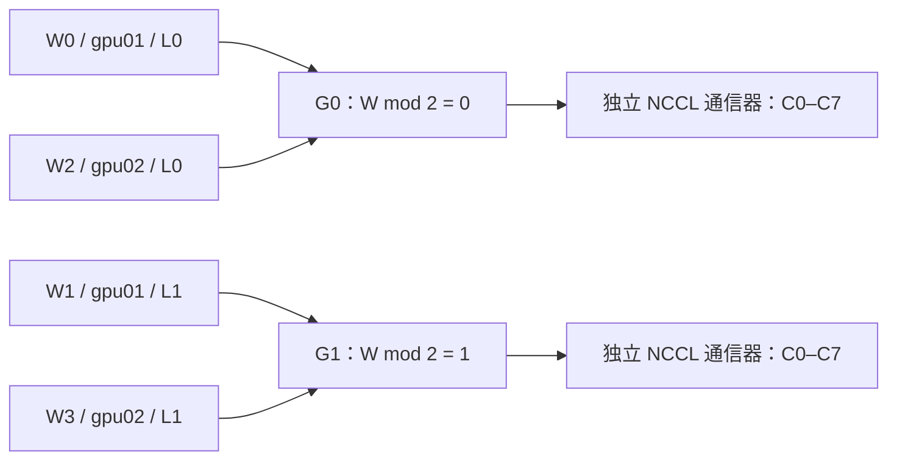
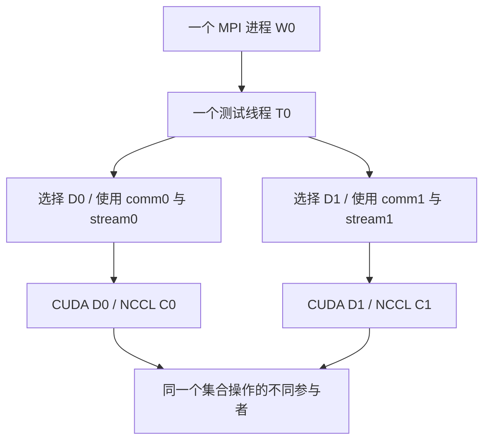
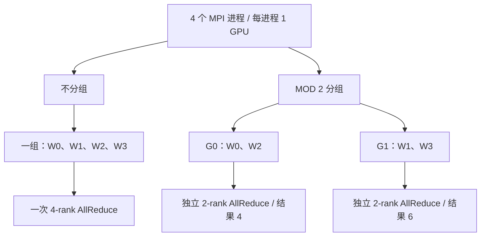

# Rank、单线程多 GPU 与 NCCL 通信分组详解

整理日期：2026-10-29。将用户提供的豆包分享分析与本轮通信分组解释合并为独立文档。采用归纳、图示和校正，不逐字转载分享全文；示例均为逻辑推算，非实测。

阅读顺序：先理解编号和层级，再看单线程多 GPU，最后看通信分组的目的与边界。

## 1. 名词及编号范围

| 名称 | 编号/作用范围 | 含义 | 常见误解 |
|---|---|---|---|
| 节点 | 一台主机 | 承载 CPU、内存、GPU、NIC 和测试进程 | 一个节点不等于一个 Rank |
| MPI 进程 | 操作系统进程 | 由启动器创建，内部可以有多个测试线程 | 一个进程不一定只管理一张 GPU |
| MPI world rank，W | `MPI_COMM_WORLD` | 全部 MPI 进程中的编号 | 不等于设备号，也不因 split 而更改 |
| 本地进程编号，L | 当前节点 | 同节点进程的序号；本地源码按同主机且 world rank 更小的进程数计算 | 不等于 split 后的组内 MPI rank |
| 线程，T | 一个 MPI 进程内 | 由 `-t` 指定的测试线程 | 不是 CUDA kernel 中的 GPU 线程 |
| 每线程 GPU 数，g | 一个测试线程内 | 由 `-g` 指定该线程管理的设备参与者数 | 不是每节点 GPU 数 |
| split color，G | 本次分组 | 相同 color 的 MPI 进程进入同一个子通信器 | color 不保证连续；也不表示节点号 |
| 组内 MPI rank，S | split 后的 MPI 子通信器 | 一个进程在该组中的编号 | 和主图中的 C 不同 |
| 组内 NCCL rank，C | 一个 NCCL 通信器 | GPU 通信参与者的编号 | G0/C0 和 G1/C0 是不同参与者 |
| CUDA device，D | 进程可见的 CUDA 设备集合 | 该进程用于选择设备的序号 | 不是全局 GPU ID；可见设备掩码可能重排编号 |

W/G/C/D 是当前原型的显示约定，不是所有工具通用的字段名。多个进程拥有相同 D 值是否冲突，要结合节点、可见设备映射和设备 UUID/PCI 标识判断。

## 2. 资源层级图

以下图中的箭头表示包含或管理关系，不表示物理通信链路。



纯文本结构（不支持 Mermaid 的阅读器也能查看）：

```text
节点
└─ MPI 进程（W / 本地 L）
   ├─ 测试线程 T0
   │  ├─ GPU 槽位 0 → CUDA D → 通信器中的 C
   │  └─ GPU 槽位 1 → CUDA D → 通信器中的 C
   └─ 测试线程 T1
      ├─ GPU 槽位 0 → CUDA D → 通信器中的 C
      └─ GPU 槽位 1 → CUDA D → 通信器中的 C
```

## 3. 数量关系及编号公式

设 MPI 进程总数为 P，每进程线程数为 t，每线程 GPU 数为 g，各进程使用相同 t/g。

```text
每进程 GPU 参与者数 K = t × g
所有进程的 GPU 参与者总数 = P × t × g
组 G 的 NCCL rank 数 = 该组 MPI 进程数 × t × g
```

这里统计的是参与者/设备槽位数。只有各参与者的设备分配不重复时，才能把它等同于不同物理 GPU 的数量。分组之后，总参与者数也不等于任意单个通信器的规模。

设线程编号为 T、线程内 GPU 槽位为 i，均从 0 开始：

```text
进程内设备槽位 slot = T × g + i
组内 NCCL rank C = S × t × g + slot
默认 CUDA 设备号 D = L × t × g + slot
显式设置 NCCL_TESTS_DEVICE=B 时：D = B + slot
```

上式来自本地源码的设备选择和 NCCL rank 初始化逻辑，适用于本文的常规测试配置。D 的默认计算使用分组前的本地进程编号 L，不使用组内 MPI rank S。

如果没有 split，S=W，故 C=W×t×g+slot。仅在 t=1、g=1、没有分组重编号时，MPI world rank 和 NCCL rank 才在这类配置中恰好相同。

## 4. 贯穿示例：2 节点、4 进程、每进程 2 线程、每线程 2 GPU

### 放置前提

- 节点 gpu01、gpu02 各有 8 张可见 GPU。
- gpu01 放置 W0、W1；gpu02 放置 W2、W3。
- 每个进程 `-t 2 -g 2`，不设置设备覆盖。
- 各进程对本节点设备的可见顺序一致；各设备不重复占用。
- 该放置是示例前提，实际启动后应检查进程和设备报告。

| 节点 | W | L | T0 管理的设备 | T1 管理的设备 | 不分组时的 C |
|---|---:|---:|---|---|---|
| gpu01 | 0 | 0 | D0、D1 | D2、D3 | C0–C3 |
| gpu01 | 1 | 1 | D4、D5 | D6、D7 | C4–C7 |
| gpu02 | 2 | 0 | D0、D1 | D2、D3 | C8–C11 |
| gpu02 | 3 | 1 | D4、D5 | D6、D7 | C12–C15 |

结果：4 个 MPI 进程、8 个测试线程、16 个 GPU 参与者、1 个包含 16 ranks 的 NCCL 通信器。不同节点上的 D0 不是同一个物理设备。

### 设置 NCCL_TESTS_SPLIT="MOD 2"

本地代码先计算 `color=W % 2`，调用 `MPI_Comm_split(MPI_COMM_WORLD, color, W, ...)`，再取得组内 MPI rank S。key 使用 W，因此组内按 W 顺序编号。整进程进入同一组，进程内线程/GPU 不会被此 split 拆到不同组。



| W | G | S（组内 MPI） | T0 的 C | T1 的 C | 使用的 D |
|---:|---:|---:|---|---|---|
| 0 | 0 | 0 | C0、C1 | C2、C3 | D0–D3 |
| 1 | 1 | 0 | C0、C1 | C2、C3 | D4–D7 |
| 2 | 0 | 1 | C4、C5 | C6、C7 | D0–D3 |
| 3 | 1 | 1 | C4、C5 | C6、C7 | D4–D7 |

```text
G0 通信器：W0 的 4 个参与者 + W2 的 4 个参与者 → C0…C7
G1 通信器：W1 的 4 个参与者 + W3 的 4 个参与者 → C0…C7
```

执行 AllReduce 时是两个独立的 8-rank 集合操作，而不是一个 16-rank AllReduce。每组都出现 C0 完全合法。分组没有把 W1 的设备从 D4–D7 改成 D0–D3。

例如主图标签 `W2 G0 C4 D0`：它属于 MPI 进程 W2、通信组 G0，在该组中编号 C4，使用 W2 可见的 CUDA D0。只写“Rank 4”会丢失通信组上下文。

### 不同 split 表达式

对 W0…W7：

| 表达式 | 分组结果 |
|---|---|
| 不设置 | 所有进程进入 G0 |
| MOD 2 | G0={0,2,4,6}；G1={1,3,5,7} |
| DIV 4 | G0={0,1,2,3}；G1={4,5,6,7} |
| AND 0x1 | 本例与 MOD 2 相同 |

分组由 W 决定，不保证对应节点边界。只有结合实际进程放置，才能判断某组是节点内还是跨节点通信。不同组也未必一样大。

## 5. 补充：把 Rank 理解为“逻辑通信点”

本节及后续相关章节结合用户提供的豆包分享《一个线程管理多个GPU的原理与实现》整理。内容采用归纳与校正，不将分享中的推论视为已验证的源码事实。

在 NCCL 集合通信语境下，可以把 rank 理解为“一个通信器内绑定到固定 CUDA 设备的逻辑通信点”。它不是 IP:port、网卡、CPU 线程，也不是节点。更准确的身份是“通信器 + rank”，再关联所在进程和设备。

- 一个 MPI 进程可以持有多个 NCCL rank 的本地通信器对象。
- 一个 NCCL rank 不跨多个 CUDA 设备，但同一个 GPU 可以参与多个不同通信器；不能反推“一张 GPU 在整个系统里只有一个 rank”。
- 数据的传输路径由实际拓扑、算法、协议与配置决定；不是每个 rank 都与所有其他 rank 建立直接物理连接。
- MPI 不是 NCCL 的必需依赖。应用可以用其他机制交换初始化信息；本文中的 MPI world rank 是 nccl-tests 的 MPI 启动模式概念。
- Keysight 图中的 Rank 是工作负载的逻辑参与者标识，在概念上接近 NCCL 通信参与者；只有结合配置绑定才能断言具体编号对应关系。

```text
身份：通信器 G0 / NCCL rank C4
   ├─ 所属进程：W2
   ├─ 操作线程：本例为 T0
   ├─ CUDA 设备：本进程可见 D0
   └─ 实际设备身份：运行时核对 UUID / PCI 地址

NIC、QP、Channel 是传输或执行资源，不能拿它们的编号替代 C4。
```

## 6. 为什么一个 CPU 线程可以管理多个 GPU

CPU 线程是调用 CUDA/NCCL API 的发起方，不需要在每张 GPU 的整个执行期间独占一个 CPU 线程。线程可以选择当前 CUDA 设备，为不同设备准备缓冲区、stream 和 NCCL 通信器，再向各自的 stream 提交工作。

`cudaSetDevice` 改变调用线程后续 CUDA 操作所用的当前设备；它不会把 GPU 0 的任务搬到 GPU 1。已提交工作是否并行以及如何推进，受 stream 依赖、NCCL 调度、硬件与版本影响，不能简单承诺“调用总是立即返回”或“所有 GPU 同时开始”。



图表示控制和参与关系，不表示两个设备的实际执行时序，也不表示物理链路。

### NCCL Group API 的作用

当同一线程驱动多个本地 GPU 参与同一个集合操作时，需要按官方 Group API 用法组织这些调用。某些调用可能等待其他参与者；若简单顺序发起并在第一个调用上等待，后续本地参与者可能得不到提交机会。Group API 将调用成组处理，避免这种单线程多设备调用模式的问题。

注意：`ncclGroupStart/End` 的“Group”是 API 调用分组，**不是** `NCCL_TESTS_SPLIT` 的通信器成员分组，两者没有相同含义。

下面是普通阻塞通信器配置下的概念代码，不是可独立编译的完整程序；省略初始化、分配、错误处理与释放：

```cpp
// 每个设备的 comm、stream 和缓冲区已在正确设备上创建。
ncclGroupStart();
for (int device = 0; device < ngpus; ++device) {
    cudaSetDevice(device);
    ncclAllReduce(sendbuf[device], recvbuf[device], count,
                  ncclFloat, ncclSum, comm[device], stream[device]);
}
ncclGroupEnd();

// GroupEnd 不等于 GPU 工作全部完成。
// 需要读取结果或确认完成时，对相应设备上的 stream 同步。
for (int device = 0; device < ngpus; ++device) {
    cudaSetDevice(device);
    cudaStreamSynchronize(stream[device]);
}
```

非阻塞通信器还需要按相应 API 检查异步状态，不能直接套用上述简化流程。也不要在尚未完成的 group 内随意同步 stream，避免等待尚未提交的工作。

本地 `common.cu` 的测试调用路径在 `args->nGpus > 1` 时使用 `ncclGroupStart/End`。因此 `-t 1 -g 4` 的含义是一个测试线程管理四个 GPU 参与者，并不意味着自动变成四个用户测试线程。NCCL 自身可能另有内部辅助线程，不能和 `-t` 混淆。

### 三种配置的对照

下表假设无 split、设备分配不重复且只有一个节点：

| MPI 进程数 | -t | -g | 用户测试线程总数 | NCCL 参与者总数 | 说明 |
|---:|---:|---:|---:|---:|---|
| 4 | 1 | 1 | 4 | 4 | 每进程一 GPU；常用于对齐一进程一 GPU 的训练部署 |
| 1 | 1 | 4 | 1 | 4 | 一个线程驱动四个设备，使用多设备 group 调用 |
| 1 | 2 | 2 | 2 | 4 | 两个测试线程，各管理两个设备 |

三者的参与者数量相同，但 CPU 调度、调用组织和进程布局不同。基准测试应匹配目标应用，不能因为单进程多 GPU 模式存在就把它视为“不受支持”或一概不适合生产。

## 7. 对分享分析中容易误解的表述作校正

| 分享中的简化表述 | 本文采用的准确解释 |
|---|---|
| 只要 -g 1，MPI rank 就等于 NCCL rank | 还需 -t 1、无 split 重编号等前提；仅 -g 1 不足以保证 |
| local rank 就是本机 GPU 编号 | 本项目中 L 是同节点进程编号；默认设备起点为 L×t×g；设备覆盖及可见性还会改变对应关系 |
| MPI 只能通信 CPU 内存 | MPI rank 是进程身份；CUDA-aware MPI 可支持设备缓冲区，不能按内存位置给 MPI rank 下定义 |
| NCCL 调用总会立即返回 | API 的主机侧返回、入队和设备完成要分别理解；行为受调用模式、group 和通信器配置影响 |
| 集合通信要求所有 GPU 同时发起 | 要求参与者按一致、合法的调用顺序参与；不是要求相同墙钟时刻调用 |
| GroupEnd 表示所有 GPU 已执行完成 | 不等于设备完成；应依据 stream 同步及通信器异步状态判断 |
| -g 4 会自动创建四个测试线程 | -t 控制测试线程数；-g 控制每线程 GPU 数 |
| 多线程操作同一 GPU 都由驱动自动串行保证安全 | stream/资源访问及 NCCL 对象使用仍需正确同步；不能以驱动为由忽略线程安全 |
| global rank 总是 NCCL rank | 必须查看日志字段及通信器上下文；可能指 MPI world rank 或其他系统的全局进程编号 |
| #wrong、i_max 可以直接定位某个掉队 rank | 错误数与最大耗时指标不自动携带明确的责任 rank；要检查原始字段及归并口径，不能编造 rank 归因 |
| 不同通信域互相不可见 | 各通信器的参与集合与编号独立；应用可以让同一设备/进程参与多个通信器，并协调这些操作 |

## 8. 通信分组：逻辑隔离会改变实际测试行为

`NCCL_TESTS_SPLIT` 是通信参与范围的逻辑划分，不是页面标签。nccl-tests 根据 MPI world rank 计算 color，将进程加入不同 MPI 子通信器，再为各组建立独立的 NCCL 通信器。因此它真实改变“谁与谁共同执行一次集合操作”。

### 单组与两组的数值示例

假设 W0～W3 每个进程各管理一张 GPU，分别持有标量 1、2、3、4，执行 SUM AllReduce：

| 参与者 | 输入 | 单个通信组的结果 | MOD 2 分组后的结果 |
|---|---:|---:|---:|
| W0 的 GPU | 1 | 10 | 4 |
| W1 的 GPU | 2 | 10 | 6 |
| W2 的 GPU | 3 | 10 | 4 |
| W3 的 GPU | 4 | 10 | 6 |

不分组时所有参与者得到 1+2+3+4=10；分组后，G0={W0,W2} 得到 1+3=4，G1={W1,W3} 得到 2+4=6。这是解释通信范围的手算示例，不是一次实测输出。



这里“独立”指参与集合和结果独立，不表示执行时间一致或硬件带宽互不影响。

### 分组的测试目的

假设 2 台节点各 4 GPU，每 GPU 一个 MPI 进程，且已确认以下放置：

```text
节点 A：W0 W1 W2 W3
节点 B：W4 W5 W6 W7
```

| 分组配置 | 实际成员 | 适合观察的范围 |
|---|---|---|
| 单个通信组 | {W0,W1,W2,W3,W4,W5,W6,W7} | 8 GPU 整体跨节点集合通信 |
| DIV 4 | G0={W0,W1,W2,W3}；G1={W4,W5,W6,W7} | 各节点内部的 4 GPU 通信，并行运行两组 |
| MOD 4 | G0={W0,W4}；G1={W1,W5}；G2={W2,W6}；G3={W3,W7} | 每组跨两节点，四组同时产生网络负载 |

这些配置可用于比较不同规模和通信范围，也可作为多组并行通信的简化负载。不能直接把它等同于完整训练任务的数据并行/张量并行调度：真实训练还有计算、依赖、通信器布局等因素。

### 四个重要边界

1. **分组按 W，不按节点名。** DIV 4 不会自动识别“每节点 4 GPU”；进程放置变化后可能不再得到节点内分组。
2. **分组以 MPI 进程为单位。** 一个进程里的所有测试线程及其 GPU 会一起进入同一组。只有一个 MPI 进程时，不能用此参数把它管理的 8 张 GPU 分为两组。
3. **分组不重新分配设备。** 默认 D 由本地进程编号 L 和 t×g 决定，不因为组内 rank 重新编号就改用 D0。
4. **分组不隔离物理资源。** 不自动独占 NIC、链路、GPU 或端口，不自动绑定 Ring/Tree 路径；不同组仍可能争用同一资源。

### 两种“Group”不要混淆

| 名称 | 分什么 | 作用 |
|---|---|---|
| `NCCL_TESTS_SPLIT` | 通信参与者 | 改变通信器成员，形成独立的集合操作 |
| `ncclGroupStart/End` | 一批 API 调用 | 协调/聚合提交，支持同线程管理多个设备；不负责拆分通信器 |

页面建议说明：**“决定哪些参与者共同执行一次集合操作。默认所有参与者属于同一组；分组后，各组并行执行独立测试，不代表物理资源隔离。”**

测试所有选定 GPU 的整体 AllReduce 性能时选“单个通信组”；需要比较节点内、跨节点或多组并发负载时再配置 split，并检查实际成员和设备映射。

### 源码依据与验证范围

本节依据项目内 [common.cu](../nccl-tests-master/src/common.cu) 的 color 计算、`MPI_Comm_split`、组内进程编号和设备选择，以及 [README](../nccl-tests-master/README.md) 的 Parallel Initialization / Parallel Tests 相关说明。编号表和数值结果为指定前提下的推算；尚未进行真实 GPU 验证。


## 9. 补充资料与核验范围

- 用户提供的豆包分享：<https://www.doubao.com/thread/xpex4RWSTRnuKTWRx>，标题《一个线程管理多个GPU的原理与实现》，本轮于 2026-10-29 读取。该页面自带 AI 内容提示，作为讨论来源而非权威接口定义。
- NCCL Communicator 官方说明：<https://docs.nvidia.com/deeplearning/nccl/user-guide/docs/usage/communicators.html>。
- NCCL Group Calls 官方说明：<https://docs.nvidia.com/deeplearning/nccl/user-guide/docs/usage/groups.html>。
- NCCL Thread Safety 官方说明：<https://docs.nvidia.com/deeplearning/nccl/user-guide/docs/usage/threadsafety.html>。
- 本地 nccl-tests 代码：[common.cu](../nccl-tests-master/src/common.cu)，核对多 GPU group 调用、线程数量与设备循环。

本次补充完善逻辑解释，不构成新的真实 GPU 执行验证；关于追踪采集的完整结论见[综合文档](nccl-rank-topology-and-observability.html)。
