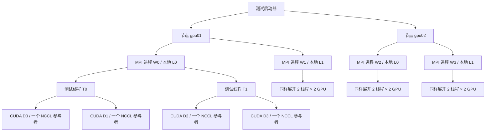
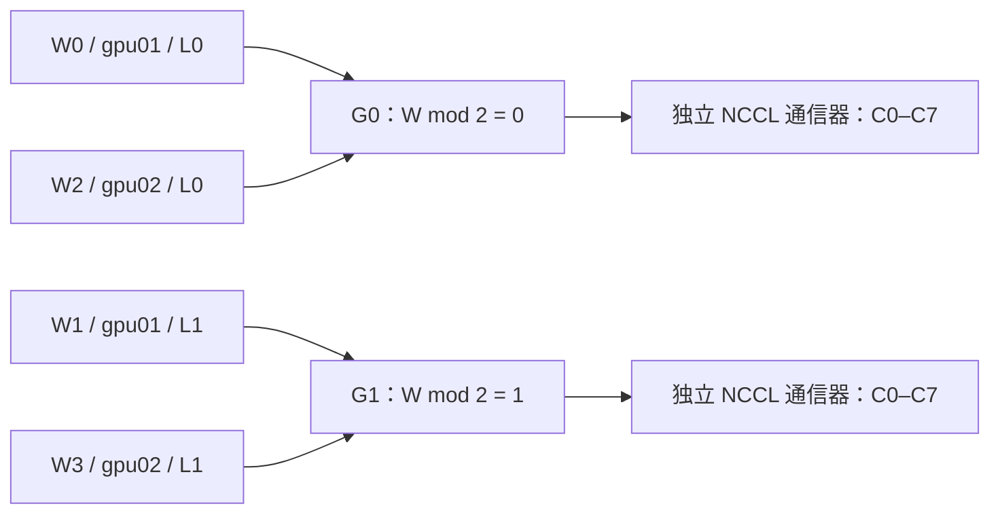
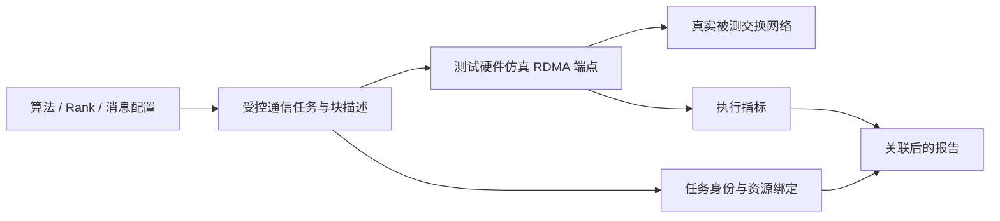
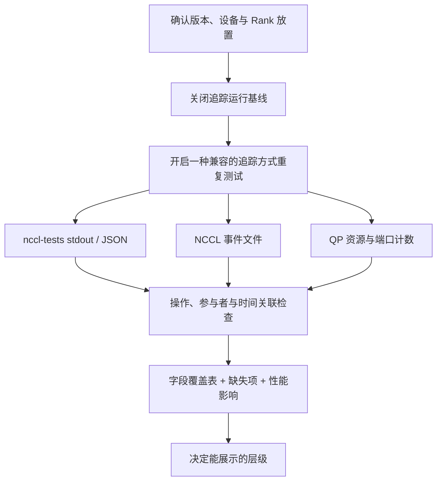
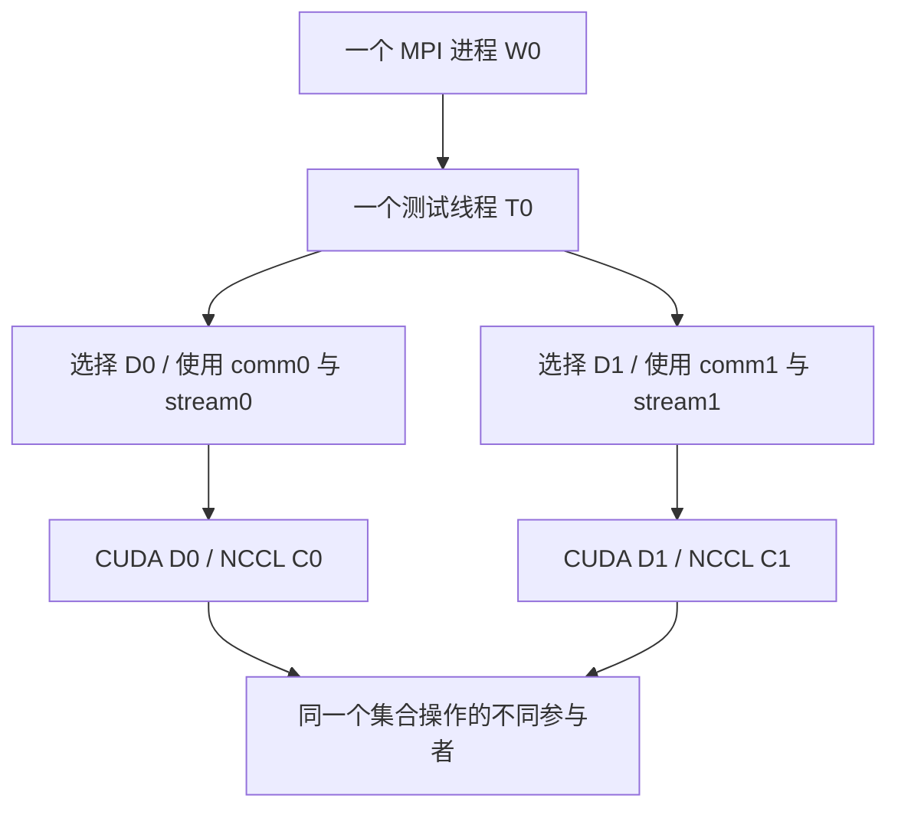

# NCCL 测试：资源拓扑、Rank 编号与追踪采集能力

整理日期：2026-10-29。本文汇总本轮已讨论结论，并核对项目内 `nccl-tests-master` 源码。所有拓扑示例均为指定配置下的推算，不代表已连接 GPU 或完成真实采集；没有通过真实环境验证的扩展能力均明确列为待验证。

## 1. 核心结论

- 节点是资源容器；MPI 进程是启动和组织测试的进程；线程是进程内的执行单元；每线程 GPU 数决定该线程管理多少个 GPU 参与者。
- Rank 是通信器内的参与者编号。MPI rank 编号对象是进程，NCCL rank 编号对象是 NCCL 通信参与者。两者不能普遍视为同一个编号。
- NCCL 分组按 MPI world rank 计算 color，然后在每个组内独立编号；分组不改变默认 CUDA 设备分配，也不表示物理网络连线。
- 标准 nccl-tests 结果文件不能还原完整的逐块 Chunks Timeline。需要额外采集运行事件，并验证语义、关联和时间对齐，不能只根据总耗时计算得到。
- Chunks、Timeline、Flows、QPairs、Ports 属于不同层次；需要组合 NCCL 追踪、RDMA 资源/计数器与端口遥测，不能承诺单个插件完整提供全部维度。

## 2. 名词及编号范围

| 名称 | 编号/作用范围 | 含义 | 常见误解 |
|---|---|---|---|
| 节点 | 一台主机 | 承载 CPU、内存、GPU、NIC 和测试进程 | 一个节点不等于一个 Rank |
| MPI 进程 | 操作系统进程 | 由启动器创建，内部可以有多个测试线程 | 一个进程不一定只管理一张 GPU |
| MPI world rank，W | `MPI_COMM_WORLD` | 全部 MPI 进程中的编号 | 不等于设备号，也不因 split 而更改 |
| 本地进程编号，L | 当前节点 | 同节点进程的序号；本地源码按同主机且 world rank 更小的进程数计算 | 不等于 split 后的组内 MPI rank |
| 线程，T | 一个 MPI 进程内 | 由 `-t` 指定的测试线程 | 不是 CUDA kernel 中的 GPU 线程 |
| 每线程 GPU 数，g | 一个测试线程内 | 由 `-g` 指定该线程管理的设备参与者数 | 不是每节点 GPU 数 |
| split color，G | 本次分组 | 相同 color 的 MPI 进程进入同一个子通信器 | color 不保证连续；也不表示节点号 |
| 组内 MPI rank，S | split 后的 MPI 子通信器 | 一个进程在该组中的编号 | 和主图中的 C 不同 |
| 组内 NCCL rank，C | 一个 NCCL 通信器 | GPU 通信参与者的编号 | G0/C0 和 G1/C0 是不同参与者 |
| CUDA device，D | 进程可见的 CUDA 设备集合 | 该进程用于选择设备的序号 | 不是全局 GPU ID；可见设备掩码可能重排编号 |

W/G/C/D 是当前原型的显示约定，不是所有工具通用的字段名。多个进程拥有相同 D 值是否冲突，要结合节点、可见设备映射和设备 UUID/PCI 标识判断。

## 3. 资源层级图

以下图中的箭头表示包含或管理关系，不表示物理通信链路。



纯文本结构（不支持 Mermaid 的阅读器也能查看）：

```text
节点
└─ MPI 进程（W / 本地 L）
   ├─ 测试线程 T0
   │  ├─ GPU 槽位 0 → CUDA D → 通信器中的 C
   │  └─ GPU 槽位 1 → CUDA D → 通信器中的 C
   └─ 测试线程 T1
      ├─ GPU 槽位 0 → CUDA D → 通信器中的 C
      └─ GPU 槽位 1 → CUDA D → 通信器中的 C
```

## 4. 数量关系及编号公式

设 MPI 进程总数为 P，每进程线程数为 t，每线程 GPU 数为 g，各进程使用相同 t/g。

```text
每进程 GPU 参与者数 K = t × g
所有进程的 GPU 参与者总数 = P × t × g
组 G 的 NCCL rank 数 = 该组 MPI 进程数 × t × g
```

这里统计的是参与者/设备槽位数。只有各参与者的设备分配不重复时，才能把它等同于不同物理 GPU 的数量。分组之后，总参与者数也不等于任意单个通信器的规模。

设线程编号为 T、线程内 GPU 槽位为 i，均从 0 开始：

```text
进程内设备槽位 slot = T × g + i
组内 NCCL rank C = S × t × g + slot
默认 CUDA 设备号 D = L × t × g + slot
显式设置 NCCL_TESTS_DEVICE=B 时：D = B + slot
```

上式来自本地源码的设备选择和 NCCL rank 初始化逻辑，适用于本文的常规测试配置。D 的默认计算使用分组前的本地进程编号 L，不使用组内 MPI rank S。

如果没有 split，S=W，故 C=W×t×g+slot。仅在 t=1、g=1、没有分组重编号时，MPI world rank 和 NCCL rank 才在这类配置中恰好相同。

## 5. 贯穿示例：2 节点、4 进程、每进程 2 线程、每线程 2 GPU

### 5.1 放置前提

- 节点 gpu01、gpu02 各有 8 张可见 GPU。
- gpu01 放置 W0、W1；gpu02 放置 W2、W3。
- 每个进程 `-t 2 -g 2`，不设置设备覆盖。
- 各进程对本节点设备的可见顺序一致；各设备不重复占用。
- 该放置是示例前提，实际启动后应检查进程和设备报告。

| 节点 | W | L | T0 管理的设备 | T1 管理的设备 | 不分组时的 C |
|---|---:|---:|---|---|---|
| gpu01 | 0 | 0 | D0、D1 | D2、D3 | C0–C3 |
| gpu01 | 1 | 1 | D4、D5 | D6、D7 | C4–C7 |
| gpu02 | 2 | 0 | D0、D1 | D2、D3 | C8–C11 |
| gpu02 | 3 | 1 | D4、D5 | D6、D7 | C12–C15 |

结果：4 个 MPI 进程、8 个测试线程、16 个 GPU 参与者、1 个包含 16 ranks 的 NCCL 通信器。不同节点上的 D0 不是同一个物理设备。

### 5.2 设置 NCCL_TESTS_SPLIT="MOD 2"

本地代码先计算 `color=W % 2`，调用 `MPI_Comm_split(MPI_COMM_WORLD, color, W, ...)`，再取得组内 MPI rank S。key 使用 W，因此组内按 W 顺序编号。整进程进入同一组，进程内线程/GPU 不会被此 split 拆到不同组。



| W | G | S（组内 MPI） | T0 的 C | T1 的 C | 使用的 D |
|---:|---:|---:|---|---|---|
| 0 | 0 | 0 | C0、C1 | C2、C3 | D0–D3 |
| 1 | 1 | 0 | C0、C1 | C2、C3 | D4–D7 |
| 2 | 0 | 1 | C4、C5 | C6、C7 | D0–D3 |
| 3 | 1 | 1 | C4、C5 | C6、C7 | D4–D7 |

```text
G0 通信器：W0 的 4 个参与者 + W2 的 4 个参与者 → C0…C7
G1 通信器：W1 的 4 个参与者 + W3 的 4 个参与者 → C0…C7
```

执行 AllReduce 时是两个独立的 8-rank 集合操作，而不是一个 16-rank AllReduce。每组都出现 C0 完全合法。分组没有把 W1 的设备从 D4–D7 改成 D0–D3。

例如主图标签 `W2 G0 C4 D0`：它属于 MPI 进程 W2、通信组 G0，在该组中编号 C4，使用 W2 可见的 CUDA D0。只写“Rank 4”会丢失通信组上下文。

### 5.3 不同 split 表达式

对 W0…W7：

| 表达式 | 分组结果 |
|---|---|
| 不设置 | 所有进程进入 G0 |
| MOD 2 | G0={0,2,4,6}；G1={1,3,5,7} |
| DIV 4 | G0={0,1,2,3}；G1={4,5,6,7} |
| AND 0x1 | 本例与 MOD 2 相同 |

分组由 W 决定，不保证对应节点边界。只有结合实际进程放置，才能判断某组是节点内还是跨节点通信。不同组也未必一样大。

## 6. 预测拓扑和实际拓扑的边界

| 情况 | 原型应如何表达 |
|---|---|
| 无 Hostfile | 根据节点列表和每节点进程上限画预测映射，标注“预测” |
| 仅填写 Hostfile 路径 | 文件内容和运行时放置未知，不虚构节点、本地 Rank、CUDA 设备映射 |
| Hostfile 模式 | 分组成员仍可由请求的 W 范围推算；节点容量、GPU 容量、设备冲突显示未验证 |
| 自动映射超出配置的可见设备范围 | 阻止生成有效预览，指出容量不足 |
| 显式起始设备 + t×g 超出可见范围 | 阻止预览，指出设备越界 |
| 显式覆盖导致同节点进程重复使用设备 | 警告；允许配置预览不等于保证 NCCL 实际可成功执行 |

同一 NCCL 通信器中的设备重复不能作为受支持的正常配置来承诺。跨组重复也可能争用资源；最终须按实际设备身份和通信器检查。

Hostfile 模式“未验证”不等于“校验通过”。远端路径不是本机可读文件，静态原型不能仅凭字符串推断远端内容。

当前页面已按用户要求移除命令预览入口；上面的“阻止预览”描述校验语义，不表示页面仍有可见命令面板。

## 7. nccl-tests 现有报告能提供什么

以项目内 `nccl-tests-master/src/util.cu` 和 `common.cu` 为依据；部署二进制是否具备这些选项仍需核对其版本和构建。

| 数据 | 本地源码支持情况 | 解释 |
|---|---|---|
| size/count/type/redop/root | 有 | 每测试点参数 |
| time、alg_bw、bus_bw、nwrong | 有 | 性能与校验结果；bus_bw 是按集合操作模型计算的指标，不是端口线速计数器 |
| devices 的 rank/group/pid/hostname/CUDA device/PCI 信息 | 有 | 参与者与设备描述，不是逐传输事件 |
| per-iteration times_us | 开启对应计时/JSON 时有 | 迭代耗时样本；不能据此恢复绝对起止时间 |
| per_process_max_times_us | 在相应 MPI 计时路径中可能有 | 不能直接解释为每 GPU、每 Chunk 的时间线 |
| tuning 的算法/协议/channels/netChunkSize | 按版本和采集条件可用 | 选择参数不是逐块执行明细 |
| 每 Chunk 的源/目的、Offset、起止事件、NIC/QP 关联 | 不提供完整事件表 | 不能直接绘制 Keysight 式逐块 Timeline |

`-I` 是迭代计时；`-S` 是报告时间戳；`-U` 是调优信息。三者均不能单独替代逐块传输追踪。

一个 100 μs 的 AllReduce 总耗时，不能唯一确定各块何时发送、哪个端口先拥塞、哪次传输先完成。把迭代耗时累加画出的图至多是估算，不能标为真实逐块时间线。

## 8. 为什么 Keysight Hardware 模式能够展示这些维度

前述官方资料对标将 Keysight Hardware 描述为使用测试硬件仿真 RDMA 端点、生成 AI 集合通信负载；Hardware 和 NCCL 是不同执行平台。此处不是把 Hardware 理解为“真实 GPU 上直接执行 NCCL”。



这是依据公开模型整理的架构说明，非 Keysight 内部实现图。测试系统控制工作负载生成，因此已知任务属于哪个集合操作、Rank 和资源，并可关联执行指标。公开 API 中有独立的数据块、Flow、QP、端口及迭代结果类别。

但截图的 Start/End 具体是提交、首包、末包还是确认时刻，需要对应版本的字段说明。不能仅凭硬件模式就断言所有时间都是网口硬件时间戳，更不能等同于无侵入还原任意真实 NCCL 内部执行。

## 9. 五类维度的采集能力矩阵

以下是实现方向和待验证边界，不是已完成能力清单。

| 维度 | 候选来源 | 可支撑的内容 | 必须验证/可能缺失 |
|---|---|---|---|
| Chunks | NCCL Profiler / 必要时补充埋点 | 部分 proxy operation/step、peer、channel、chunk size | step 是否等同业务定义的 chunk；唯一块 ID、offset、两端配对、完整性 |
| Timeline | NCCL 事件、Nsight Systems 或其他事件流 | 已采集事件的起止/持续时间与层级 | 时间语义、跨节点对齐、是否能支持逐块连线 |
| Flows | NCCL 逻辑关系 + RDMA/网络观测 | Rank 对的逻辑流，或明确口径的网络流 | 明确 flow 定义；逻辑流与 QP/实际网络流的多对多关系 |
| QPairs | RDMA 资源查询、驱动/硬件计数器 | QP 资源及受支持的统计 | 支持哪些计数；是否按单 QP；进程/Rank/Channel 归属 |
| Ports | NIC 端口计数器、交换机遥测 | 字节/包/错误等受支持指标 | 时间区间、单位、采样、背景流量；不自动归属某迭代或某块 |

QP 自动统计可能按 PID/类型汇聚多个 QP，不能未经检查就把一组计数写成单 QP 指标。端口计数也是聚合观测：有流量增加不等于知道哪个 Chunk 使用了这些字节。

## 10. 为什么要验证“事件关联能力”

能记录事件 ≠ 能还原完整数据块传输。需检查四件事：

1. **粒度**：API、collective、GPU 活动、proxy operation、proxy step 不同层；不能统一命名为 Chunk。
2. **身份**：操作序号通常有作用域；需结合任务、通信器、进程/Rank、Channel、peer 和步骤标识，判断哪些字段能唯一关联。以下关联键是设计目标，不保证原始接口全部提供。
3. **时间**：主机 API 返回、代理完成、GPU 完成和物理端口收发不是同一边界。不同主机时钟不能直接假设一致。
4. **完整性与开销**：记录是否丢失、缓存是否不足、开关追踪是否影响性能；遗漏事件不能解释成零耗时或无通信。

```text
可能需要的关联路径（每条箭头均需验证）
运行任务 → 通信器 → collective 操作 → Rank/Channel/Step
                                      ↓
                               逻辑 Chunk 或 Flow
                                      ↓
                                  RDMA QP
                                      ↓
                                NIC / 端口 / 时间窗
```

NCCL 官方已有 Profiler 示例插件，通常不需要从零开发追踪机制，也不一定要修改 nccl-tests。优先验证现有接口；缺失关键字段时才评估补充插件或底层埋点。Nsight Systems 与直接 Profiler 插件采集是候选路线，不能未经兼容性检查就假设可同时加载。

## 11. “拿一轮真实采集结果”具体指什么

指在**我们的 GPU/RDMA 环境**运行 nccl-tests 并采集，不是要求先拿 Keysight 导出文件。

| 样本 | 用途 |
|---|---|
| 我们的 nccl-tests + 追踪 + RDMA/端口记录 | 验证真实能取得哪些字段，以及能否可靠关联 |
| Keysight 导出结果和对应字段手册 | 对标目标语义和页面字段；有帮助，但不是前提 |

建议试验：2 台节点、每节点 1 GPU、每 GPU 1 MPI 进程、固定 AllReduce 消息大小、少量迭代。具体参数由设备和版本确认。



采集清单：
- nccl-tests/NCCL/CUDA/MPI/驱动/网卡版本、完整启动参数、可见设备和实际 Rank 映射。
- stdout/stderr、JSON、每节点追踪原文件和记录完整性信息。
- QP 资源信息、计数器统计范围、端口测试前后值或期间采样。
- 时钟来源、同步方式和可估计的时间误差；保存与同一轮测试关联的时间窗。
- 无追踪基线与开启追踪的结果，评估扰动。归档环境变量时脱敏凭据。

验收原则：能唯一关联操作，才画操作关联；能配对逐块事件，才画逐块跨 Rank 连线；缺失字段写“未采集/未验证”，不填零、不推造事件。

## 12. 原型演进建议

1. 现有报告继续展示摘要、详情、迭代耗时；拓扑是资源与编号关系，和运行时追踪图分开。
2. 先验证 Ports 和按 Rank 的集合操作 Timeline，明确测量边界。
3. 再接入 QPairs 与定义清楚的 Flows，展示关联置信与统计范围。
4. 最后验证 Chunks 与逐块 Timeline；数据不足时不把操作级图改名为块级图。
5. 拓扑图不画未经采集的物理链路；分组清单不意味着 Ring/Tree 的实际通信边。

## 13. 证据与后续核验入口

### 本地已核对源码
- [common.cu](../nccl-tests-master/src/common.cu)：MPI world/local rank、NCCL_TESTS_SPLIT、MPI_Comm_split、NCCL_TESTS_DEVICE、NCCL rank 初始化；本轮核对主要在 1571–1660 行附近。
- [util.cu](../nccl-tests-master/src/util.cu)：设备报告、性能对象、逐迭代 JSON、调优字段与报告时间戳。
- [计时语义和报告结构研究](nccl-report-and-timing-research.md)：详细字段来源与计时注意事项。
- [原有 Rank 拓扑详解](nccl-tests-rank-topology.md)：补充无分组及其他分组图例。

### 前述讨论使用的官方资料（采集实施前按实际版本复核）
- NVIDIA nccl 的 `plugins/profiler/example/README.md`：事件类别、输出示例和缓冲区限制。
- NVIDIA Nsight Systems User Guide 的 NCCL tracing 部分：支持版本、事件类型及采集配置。
- Linux iproute2 的 `rdma-statistic(8)`、`rdma-resource(8)` 与 InfiniBand sysfs ABI：QP/端口接口及统计口径。
- Keysight AI Data Center Builder 的 solution introduction、Client API Reference：平台模式、绑定模型及结果类别。

本文没有新增真实采集证据；关于上述工具的能力范围汇总自前述分析，不作为任何指定环境的可用性保证。最终上线字段应以版本锁定后的官方定义和实际样本为准。

## 14. 补充：把 Rank 理解为“逻辑通信点”

本章及后续章节结合用户提供的豆包分享《一个线程管理多个GPU的原理与实现》整理。内容采用归纳与校正，不将分享中的推论视为已验证的源码事实。

在 NCCL 集合通信语境下，可以把 rank 理解为“一个通信器内绑定到固定 CUDA 设备的逻辑通信点”。它不是 IP:port、网卡、CPU 线程，也不是节点。更准确的身份是“通信器 + rank”，再关联所在进程和设备。

- 一个 MPI 进程可以持有多个 NCCL rank 的本地通信器对象。
- 一个 NCCL rank 不跨多个 CUDA 设备，但同一个 GPU 可以参与多个不同通信器；不能反推“一张 GPU 在整个系统里只有一个 rank”。
- 数据的传输路径由实际拓扑、算法、协议与配置决定；不是每个 rank 都与所有其他 rank 建立直接物理连接。
- MPI 不是 NCCL 的必需依赖。应用可以用其他机制交换初始化信息；本文中的 MPI world rank 是 nccl-tests 的 MPI 启动模式概念。
- Keysight 图中的 Rank 是工作负载的逻辑参与者标识，在概念上接近 NCCL 通信参与者；只有结合配置绑定才能断言具体编号对应关系。

```text
身份：通信器 G0 / NCCL rank C4
   ├─ 所属进程：W2
   ├─ 操作线程：本例为 T0
   ├─ CUDA 设备：本进程可见 D0
   └─ 实际设备身份：运行时核对 UUID / PCI 地址

NIC、QP、Channel 是传输或执行资源，不能拿它们的编号替代 C4。
```

## 15. 为什么一个 CPU 线程可以管理多个 GPU

CPU 线程是调用 CUDA/NCCL API 的发起方，不需要在每张 GPU 的整个执行期间独占一个 CPU 线程。线程可以选择当前 CUDA 设备，为不同设备准备缓冲区、stream 和 NCCL 通信器，再向各自的 stream 提交工作。

`cudaSetDevice` 改变调用线程后续 CUDA 操作所用的当前设备；它不会把 GPU 0 的任务搬到 GPU 1。已提交工作是否并行以及如何推进，受 stream 依赖、NCCL 调度、硬件与版本影响，不能简单承诺“调用总是立即返回”或“所有 GPU 同时开始”。



图表示控制和参与关系，不表示两个设备的实际执行时序，也不表示物理链路。

### 15.1 NCCL Group API 的作用

当同一线程驱动多个本地 GPU 参与同一个集合操作时，需要按官方 Group API 用法组织这些调用。某些调用可能等待其他参与者；若简单顺序发起并在第一个调用上等待，后续本地参与者可能得不到提交机会。Group API 将调用成组处理，避免这种单线程多设备调用模式的问题。

注意：`ncclGroupStart/End` 的“Group”是 API 调用分组，**不是** `NCCL_TESTS_SPLIT` 的通信器成员分组，两者没有相同含义。

下面是普通阻塞通信器配置下的概念代码，不是可独立编译的完整程序；省略初始化、分配、错误处理与释放：

```cpp
// 每个设备的 comm、stream 和缓冲区已在正确设备上创建。
ncclGroupStart();
for (int device = 0; device < ngpus; ++device) {
    cudaSetDevice(device);
    ncclAllReduce(sendbuf[device], recvbuf[device], count,
                  ncclFloat, ncclSum, comm[device], stream[device]);
}
ncclGroupEnd();

// GroupEnd 不等于 GPU 工作全部完成。
// 需要读取结果或确认完成时，对相应设备上的 stream 同步。
for (int device = 0; device < ngpus; ++device) {
    cudaSetDevice(device);
    cudaStreamSynchronize(stream[device]);
}
```

非阻塞通信器还需要按相应 API 检查异步状态，不能直接套用上述简化流程。也不要在尚未完成的 group 内随意同步 stream，避免等待尚未提交的工作。

本地 `common.cu` 的测试调用路径在 `args->nGpus > 1` 时使用 `ncclGroupStart/End`。因此 `-t 1 -g 4` 的含义是一个测试线程管理四个 GPU 参与者，并不意味着自动变成四个用户测试线程。NCCL 自身可能另有内部辅助线程，不能和 `-t` 混淆。

### 15.2 三种配置的对照

下表假设无 split、设备分配不重复且只有一个节点：

| MPI 进程数 | -t | -g | 用户测试线程总数 | NCCL 参与者总数 | 说明 |
|---:|---:|---:|---:|---:|---|
| 4 | 1 | 1 | 4 | 4 | 每进程一 GPU；常用于对齐一进程一 GPU 的训练部署 |
| 1 | 1 | 4 | 1 | 4 | 一个线程驱动四个设备，使用多设备 group 调用 |
| 1 | 2 | 2 | 2 | 4 | 两个测试线程，各管理两个设备 |

三者的参与者数量相同，但 CPU 调度、调用组织和进程布局不同。基准测试应匹配目标应用，不能因为单进程多 GPU 模式存在就把它视为“不受支持”或一概不适合生产。

## 16. 对分享分析中容易误解的表述作校正

| 分享中的简化表述 | 本文采用的准确解释 |
|---|---|
| 只要 -g 1，MPI rank 就等于 NCCL rank | 还需 -t 1、无 split 重编号等前提；仅 -g 1 不足以保证 |
| local rank 就是本机 GPU 编号 | 本项目中 L 是同节点进程编号；默认设备起点为 L×t×g；设备覆盖及可见性还会改变对应关系 |
| MPI 只能通信 CPU 内存 | MPI rank 是进程身份；CUDA-aware MPI 可支持设备缓冲区，不能按内存位置给 MPI rank 下定义 |
| NCCL 调用总会立即返回 | API 的主机侧返回、入队和设备完成要分别理解；行为受调用模式、group 和通信器配置影响 |
| 集合通信要求所有 GPU 同时发起 | 要求参与者按一致、合法的调用顺序参与；不是要求相同墙钟时刻调用 |
| GroupEnd 表示所有 GPU 已执行完成 | 不等于设备完成；应依据 stream 同步及通信器异步状态判断 |
| -g 4 会自动创建四个测试线程 | -t 控制测试线程数；-g 控制每线程 GPU 数 |
| 多线程操作同一 GPU 都由驱动自动串行保证安全 | stream/资源访问及 NCCL 对象使用仍需正确同步；不能以驱动为由忽略线程安全 |
| global rank 总是 NCCL rank | 必须查看日志字段及通信器上下文；可能指 MPI world rank 或其他系统的全局进程编号 |
| #wrong、i_max 可以直接定位某个掉队 rank | 错误数与最大耗时指标不自动携带明确的责任 rank；要检查原始字段及归并口径，不能编造 rank 归因 |
| 不同通信域互相不可见 | 各通信器的参与集合与编号独立；应用可以让同一设备/进程参与多个通信器，并协调这些操作 |

## 17. 补充资料与核验范围

- 用户提供的豆包分享：<https://www.doubao.com/thread/xpex4RWSTRnuKTWRx>，标题《一个线程管理多个GPU的原理与实现》，本轮于 2026-10-29 读取。该页面自带 AI 内容提示，作为讨论来源而非权威接口定义。
- NCCL Communicator 官方说明：<https://docs.nvidia.com/deeplearning/nccl/user-guide/docs/usage/communicators.html>。
- NCCL Group Calls 官方说明：<https://docs.nvidia.com/deeplearning/nccl/user-guide/docs/usage/groups.html>。
- NCCL Thread Safety 官方说明：<https://docs.nvidia.com/deeplearning/nccl/user-guide/docs/usage/threadsafety.html>。
- 本地 nccl-tests 代码：[common.cu](../nccl-tests-master/src/common.cu)，核对多 GPU group 调用、线程数量与设备循环。

本次补充完善逻辑解释，不构成新的真实 GPU 执行验证；此前关于 Chunks、Timeline、Flows、QPairs、Ports 的采集边界仍然成立。
