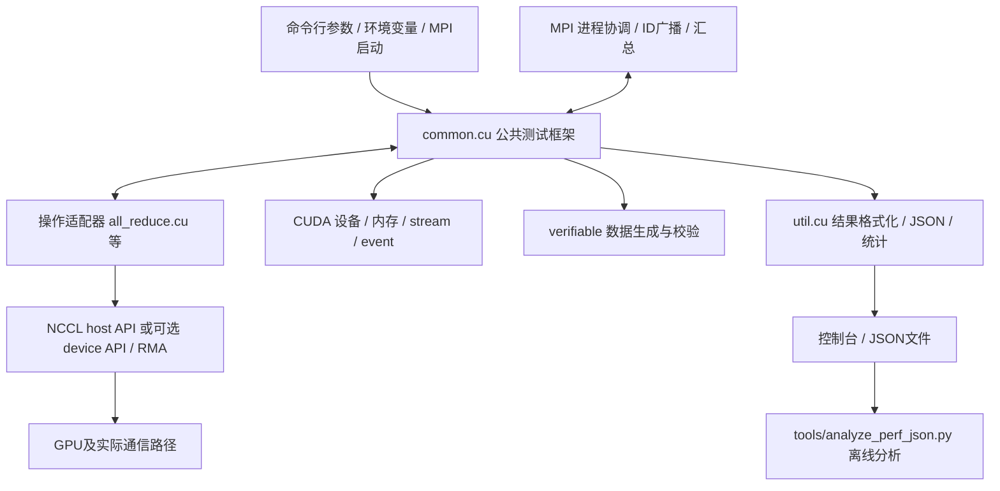

# nccl-tests 整体架构与功能模块

研究日期：2026-10-26。范围：源码静态分析；未执行 GPU 性能测试。基线目录：`E:/dpi/nccl-tests-master`。2026-10-26 查询上游 master 得到提交 `afd59abab774a6a4b492eb344bd0c845a0b7bb4d`（提交时间 2026-10-05T19:40:17Z）；逐一比较上游树的 79 个文件，均存在且 Git blob 哈希一致。这是 master 快照核验，不是最新正式 release 声明。上游提交与逐文件核验见 [来源核验](nccl-source-verification.json)。本文先建立架构，不设计 WebUI。

## 1. 系统边界

nccl-tests 是测试 NCCL 通信性能和结果正确性的程序集合。常规 collective 测试由“公共测试框架 + 一个操作适配器 + 工具/验证模块”链接成单独的可执行文件。它组织可重复的测试工作负载，调用 NCCL，并计算/输出测量结果。普通 host API 路径的具体通信算法、协议和传输实现属于链接的 NCCL 库；本版本还包含 device API / host RMA 等可选实现路径，因此不能笼统说仓库里完全没有通信 kernel。

依据：[构建链接规则](../nccl-tests-master/src/Makefile#L45)、[调用分支](../nccl-tests-master/src/common.cu#L554)、[适配接口](../nccl-tests-master/src/common.h#L115)。



图描述常规 collective 测试；comm_ops 和 GIN 是另外的测试入口，不经过完全相同的公共执行主链。

## 2. 三类测试入口

| 类别 | 作用 | 源码与约束 |
|---|---|---|
| Collective / 通信模式性能测试 | 对消息大小、类型、规约操作等进行扫描，测量耗时与带宽并校验结果 | `src/all_reduce.cu`、`all_gather.cu`、`reduce_scatter.cu`、`broadcast.cu`、`reduce.cu`、`alltoall.cu`、`alltoallv.cu`、`gather.cu`、`scatter.cu`、`sendrecv.cu`、`hypercube.cu`；实际构建由依赖版本决定 |
| 通信器操作测试 | 测量 init / split / shrink / grow 的操作延迟 | `src/comm_ops.cu` 有自己的 main 和参数；不是消息传输带宽测试 |
| GIN device API 微基准 | 测量 GPU 发起的 put/get/signal 等操作延迟、带宽或消息速率 | `src/device_api/gin/`；本地 README 要求 MPI、NCCL >= 2.30.7、两个 rank 且每 rank 一个 GPU |

依据：[程序列表与编译条件](../nccl-tests-master/src/Makefile#L45)、[通信器入口](../nccl-tests-master/src/comm_ops.cu#L1177)、[GIN说明](../nccl-tests-master/src/device_api/gin/README.md#L1)。这些条件描述本次源码，不是所有历史版本的能力。

## 3. 功能模块职责

| 模块 | 职责 | 入口/接口 |
|---|---|---|
| 构建系统 | 选择 CUDA/NCCL/MPI 依赖、条件编译、生成每种测试二进制 | 根目录和 src 的 Makefile / CMakeLists.txt |
| 配置入口 | 解析命令行、检查参数组合、初始化输出、启动运行 | `common.cu:1151 main` |
| 进程与设备组织 | 获取 MPI rank/local rank、按 color 分组、广播 NCCL unique ID、配置 GPU、分配缓冲和线程参数 | `common.cu:1570 run` |
| 执行上下文 | 携带 GPU、stream、communicator、buffer、规模、错误与带宽累计信息 | `common.h:152 threadArgs` |
| 操作适配层 | 定义某个 collective 的数据量、数据初始化、调用方式、带宽换算，枚举适用测试组合 | `common.h:115 testColl`、`:134 testEngine`；各操作 .cu |
| 扫描与执行层 | 扫描消息规模，对 out-of-place 和 in-place 分别执行预热、正式测量、校验 | `common.cu:942 TimeTest`、`:720 BenchTime` |
| 调用与同步层 | 逐 GPU 发起操作，处理 group 调用及可选实现，等待完成并检查异步错误/超时 | `common.cu:554 startColl`、`:655 completeColl`、`:496 testStreamSynchronize` |
| 正确性模块 | 生成可验证输入、构造预期结果、检查数据与越界区域 | `verifiable/`、`common.cu:277 CheckDelta`、`:449 CheckData` |
| 测量与统计 | 整体迭代计时；可选 CUDA event 单迭代计时；跨线程/进程归并；统计分位数等 | `common.cu:666 getElapsedTimes`、`:720 BenchTime`；`util.cu:632 computeIterStats` |
| 报告模块 | 输出设备信息、结果表、JSON、错误与可选内存/tuning信息 | `util.cu:364 jsonOutputInit`、`:594 writeBenchmarkLineBody`、`:719 writeDeviceReport`、`:895 writeResultFooter` |
| 平台辅助与后处理 | 操作系统差异封装；分析已生成的单迭代 JSON | `os/os.h`、`os/linux.cc`、`os/windows.cc`；`tools/analyze_perf_json.py` |

## 4. 最重要的两个接口

`testEngine` 是“如何展开这一类测试”的接口：`getBuffSize` 决定缓冲区需求，`runTest` 枚举适用的类型、规约操作、root 等组合并进入公共计时逻辑；另有受 NCCL 版本约束的通信器配置/device requirements 回调。

`testColl` 是“一次操作如何做”的接口：`getCollByteCount` 计算发送/接收/调用数据量和原地偏移；`initData` 初始化；`runColl` 发起操作；`getBw` 将测量时间转换为该操作的带宽口径。

这是编译链接时接入的 C/C++ 函数指针接口，不是运行时 Web 插件系统。[接口定义](../nccl-tests-master/src/common.h#L115)、[链接规则](../nccl-tests-master/src/Makefile#L124)。

## 5. 常规测试主链

```text
main：参数解析、合法性检查、MPI/输出初始化
  → run：进程分组、设备信息、NCCL ID、内存/stream/communicator准备
  → threadRunTests（parallel_init时先经过threadInit）
  → ncclTestEngine.runTest：选择具体测试组合
  → TimeTest：遍历消息大小和运行周期
      → BenchTime(out-of-place)
      → BenchTime(in-place)
          → 可选数据初始化
          → warmup → 完成同步 → Barrier
          → timed iterations × aggregation → 完成同步
          → 计算时间、跨线程/进程归并、getBw换算
          → 单独的正确性测试与错误汇总
          → 写入结果，按需写单迭代统计
  → 汇总、报告、释放资源、MPI结束
```

依据：[线程入口](../nccl-tests-master/src/common.cu#L979)、[扫描](../nccl-tests-master/src/common.cu#L942)、[计时与校验](../nccl-tests-master/src/common.cu#L720)、[线程装配](../nccl-tests-master/src/common.cu#L1825)。上图中的 in-place 是框架尝试路径；具体操作可明确拒绝该模式（如 AlltoAll、SendRecv），不能认为所有操作均支持。不同 blocking / CUDA Graph 模式会调整同步与计时路径，不应把示意链当成所有模式的逐行时序。

## 6. 必须先建立的概念

- **MPI进程不等于NCCL rank。** 常规均匀配置、未分组时，总 rank 数是进程数 × 每进程线程数 × 每线程 GPU 数。启用 split 时，要按组内进程数理解 communicator 大小；color 在本源码中按进程号计算。参考 [README](../nccl-tests-master/README.md#L37)、[分组代码](../nccl-tests-master/src/common.cu#L1570)。
- **MPI和NCCL职责不同。** 这里 MPI 用于进程协调、ID 分发和结果归并；被测普通集合通信调用进入 NCCL。参考 [run](../nccl-tests-master/src/common.cu#L1570)、[startColl](../nccl-tests-master/src/common.cu#L554)。
- **time不是一律“CUDA event测出的纯kernel时间”。** 常规总体计时从CPU计时器出发并等待操作完成；单迭代功能另用event；CPU-time选项及blocking/graph模式改变口径。参考 [BenchTime](../nccl-tests-master/src/common.cu#L720)。
- **algbw和busbw是计算结果。** busbw 使用操作相关换算因子，不是 NIC 端口计数器直接测到的实际线速。参考 [PERFORMANCE](../nccl-tests-master/doc/PERFORMANCE.md#L1)。
- **性能迭代与校验迭代分开。** 正式计时后还会重新初始化并执行校验；不能把 #wrong=0 解读为所有计时迭代逐一通过校验。关闭校验时也不能声称校验通过。参考 [BenchTime](../nccl-tests-master/src/common.cu#L720)。
- **配置不一定等于实际执行规模。** 本地 run 会根据可用显存约束缩减 maxBytes；解读报告必须看实际输出。参考 [显存限制](../nccl-tests-master/src/common.cu#L1628)。

## 7. 后续阅读顺序

先用 AllReduce 贯穿“输入→执行→结果”主链，再阅读 rank/communicator 初始化、消息规模与缓冲区计算、计时与统计、正确性验证、不同 collective 的差异。随后覆盖高级选项与两个独立微基准框架。需要解释 NCCL 算法选择和底层传输时再引入匹配版本的 NCCL 源码。WebUI 原型不属于本阶段。

相关细读：[collective与指标研究](nccl-collectives-metrics-research.md)。

