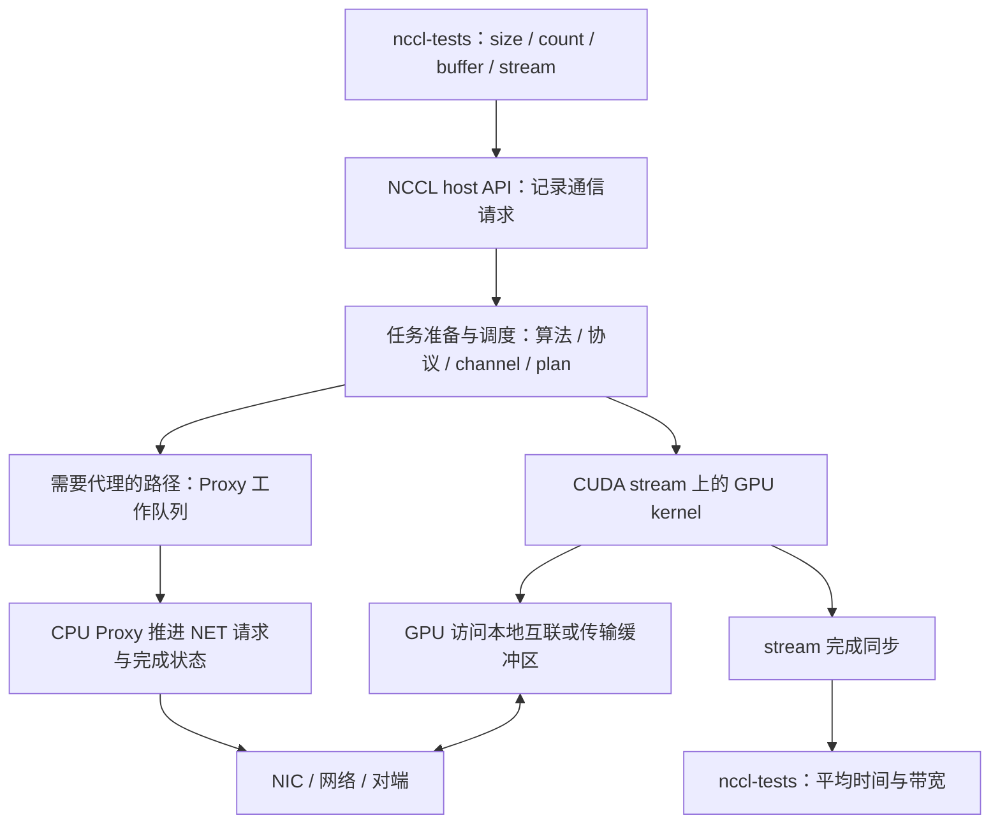

# NCCL 与 nccl-tests 源码学习：从测试驱动到通信执行

本笔记依据当前本地 nccl-tests 源码静态阅读。目录无 Git 元数据，不能把目录名 master 当作官方版本；已有 [逐文件核验记录](nccl-source-verification.json) 记载了此前比对的 nccl-tests 上游提交，但它与 NCCL 库本身的版本是两回事。没有执行 GPU/RDMA 实测。NCCL 核心实现的固定版本研究另见 [核心执行链笔记](nccl-core-architecture-research-notes.md)。下面的本地文件链接用于直接定位函数。

## 1. 先固定学习路径

先研究 `deviceImpl=0`、不启用 CUDA Graph、普通 collective 的路径。当前源码还提供 Device API、LSA/Multimem、Host RMA 分支；这些分支不能与传统 NCCL host API 的执行链混为一谈。

nccl-tests 是基准测试驱动；NCCL 是被测通信库；CUDA stream 是提交工作的顺序上下文；MPI 在这个测试程序中主要协助多进程初始化、元数据交换和统计归并，不表示 GPU collective 数据由 MPI 搬运。

## 2. 测试程序的两个扩展接口

[`testEngine` 与 `testColl`](../nccl-tests-master/src/common.h#L115) 是理解代码组织的入口。

| 接口 | 函数 | 职责 |
|---|---|---|
| testEngine | getBuffSize | 根据最大测试尺寸和 rank 数确定缓冲需求 |
| testEngine | runTest | 遍历 datatype、reduction op 等测试组合 |
| testColl | getCollByteCount | 将统一测试 size 换算为发送、接收、API count、in-place 偏移 |
| testColl | initData | 构造输入和预期输出 |
| testColl | runColl | 调用 NCCL API，或选定的高级实现 |
| testColl | getBw | 按 collective 的数据量语义和实测时间计算带宽 |

AllReduce 的默认 [`AllReduceRunColl`](../nccl-tests-master/src/all_reduce.cu#L500) 调用 `ncclAllReduce`。但并不是所有适配器都只包装一个 NCCL 函数：SendRecv 用成组 Send/Recv，部分测试还有高级实现分支。

## 3. 普通 AllReduce 的可跟读调用链

```text
main：解析参数、版本能力和输出配置
  → run：多进程元信息、GPU/stream/buffer/communicator、线程组织
  → threadRunTests
  → ncclTestEngine.runTest / AllReduceRunTest
  → TimeTest：扫描 size，分别执行 out-of-place / in-place
  → setupArgs：换算 buffer/API count
  → BenchTime：初始化、warmup、计时、同步、带宽、单独校验
  → startColl：逐本地 GPU 选择 buffer、comm、stream
  → args->collTest->runColl / AllReduceRunColl
  → ncclAllReduce：进入 NCCL 库
```

入口见 [`main`](../nccl-tests-master/src/common.cu#L1151)、[`threadRunTests`](../nccl-tests-master/src/common.cu#L980)、[`TimeTest/setupArgs`](../nccl-tests-master/src/common.cu#L927)、[`BenchTime`](../nccl-tests-master/src/common.cu#L719)、[`startColl`](../nccl-tests-master/src/common.cu#L553)。这不是每个构建模式下唯一的初始化调用路径，parallel_init 等选项会调整资源初始化的位置。

## 4. Rank、进程、线程与 GPU

在未额外拆分 communicator 的普通配置中，测试代码使用的 rank 总数为参与进程数 × 每进程线程数 × 每线程 GPU 数；rank 可按 `(proc * nThreads + thread) * nGpus + gpuIndex` 计算。源码见 [`startColl`](../nccl-tests-master/src/common.cu#L563)。

例如 2 个 MPI 进程、每进程 1 个线程、每线程 2 个 GPU：进程 0 管理 rank 0/1，进程 1 管理 rank 2/3。是否对应两个物理节点取决于进程部署，并非由进程数直接决定。启用 split 后需要使用分组后的进程/rank 作用域，不能套用全局 rank 代替组内 rank。

[`initComms`](../nccl-tests-master/src/common.cu#L200) 为各 GPU 创建 communicator。communicator 表示参加本组通信的上下文；同一个 CPU 线程可管理多个本地 GPU 对应的 NCCL communicator。多 GPU 初始化/提交使用 group 包裹，不能把这种 group 理解成主机线程数或一条物理链路。

## 5. size、count 与 buffer 的区别

`size` 是测试框架扫描的数据尺寸；`count` 是传给具体 NCCL API 的元素个数；`datatype` 决定每个元素字节数。它们通过算子适配器换算，而不是所有算子共用一个字节公式。

- AllReduce：每 rank 输入 S，输出 S；API count 为 S / datatype_size。
- AllGather：每 rank 提供一段，输出所有 rank 段的拼接；API sendcount 不能当完整输出数组长度。
- ReduceScatter：每 rank 输入完整归约数组，输出其负责的一段；API recvcount 是每 rank 输出段元素数。

换算入口是 [`setupArgs`](../nccl-tests-master/src/common.cu#L927) 和各测试的 getCollByteCount。`startColl` 还轮换 buffer 偏移以减少缓存效应，因此不能看见指针变化就推断为应用层 chunk offset。

## 6. 计时究竟测什么

[`BenchTime`](../nccl-tests-master/src/common.cu#L719) 先运行 warmup，再运行 measured iterations。普通路径会在计算完成时间前调用 completeColl，等待 CUDA stream 上工作完成；API 返回不是 GPU 完成。

若 `-n 20 -m 4`，每个 rank 的 measured loop 发起 80 次 collective，常规时间再除以 80。启用 per-iteration CUDA Event 时，计时事件包围一组 4 次操作，其样本再除以 4。因此它是“该组平均每次操作的时间”，不是分别观察到了四个独立 collective 的 duration。依据 [`measured loop`](../nccl-tests-master/src/common.cu#L759)、[`getElapsedTimes`](../nccl-tests-master/src/common.cu#L666)、[`平均计时`](../nccl-tests-master/src/common.cu#L795)。

CPU time、blocking mode、CUDA Graph 会改变计时边界。特别是 CPU time 在等待最终完成之前记录，因此不应无条件解释为设备执行时间；本地实现也禁止 per-iteration timing 和 CUDA Graph 同时使用。跨 rank 的 `-a` 归并规则与 reduction op 是两套概念。

实际输出把秒乘 1e6，`time`/`cpu_time` 是微秒；CUDA Event 原始值为毫秒，导出时要换算。不能沿用性能文档开头的 ms 直接解析。依据 [`timeUsec`](../nccl-tests-master/src/common.cu#L886)、[`结果写出`](../nccl-tests-master/src/util.cu#L594)。

## 7. 带宽与正确性

AllReduce 实现使用 `algbw = count × datatype_size / time / 1e9`，`busbw = algbw × 2(N−1)/N`；源码见 [`AllReduceGetBw`](../nccl-tests-master/src/all_reduce.cu#L59)。4 rank、每 rank 64 MiB、耗时 1 ms，得到 algbw≈67.11 GB/s、busbw≈100.66 GB/s。后一个数是归一化推导量，不是某张 NIC 的端口测量值；单机 GPU 互联也可能产生该结果。

正确性检查在性能计时结束之后重新初始化、发起检查用 collective、同步并比较预期输出；不是逐个验证每一轮性能迭代。依据 [`datacheck`](../nccl-tests-master/src/common.cu#L828)。`#wrong=0` 还应结合是否启用检查、适配器是否提供错误报告判断。

## 8. 与 Proxy 采集阶段的关系

目前本地内置 profiler 是 tuning 信息提取器，不是完整的高频事件追踪器。它在 init 启用 Coll/P2P/ProxyOp/CE，只保存代表性 chunkSize，recordEventState 为空；见 [`profiler 实现`](../nccl-tests-master/src/util.cu#L985)。`-U` 会把 NCCL_PROFILER_PLUGIN 设置为 STATIC_PLUGIN，当前程序会打印覆盖提示；这与产品应当提供冲突预检是不同层面的事实。

NCCL API、Collective、GPU Kernel Channel、ProxyOp、ProxyStep 是不同观测边界；rank、peer、channel 是逻辑上下文；QP、WR、NIC 端口需要网络层事件及设备元数据。主机 profiler 时间和 GPU pTimer 不应未经校准直接相减。

## 9. 建议的阅读练习

1. 只看普通 AllReduce 路径：从 AllReduceRunTest 找到 runColl 的函数指针绑定，再跟到 ncclAllReduce。
2. 把参数设想为 4 rank、float32、64 MiB：手算 API count、输入/输出 buffer 大小，再核对 getCollByteCount。
3. 比较 `-m 1` 与 `-m 4` 的 measured loop 和 Event 数量，解释为什么 times_us 不是逐 ProxyStep 样本。
4. 找出 completeColl 与 cudaStream 同步的位置，解释 API 返回与工作完成的差别。
5. 将相同 size 的 AllGather 与 ReduceScatter 对比，先计算 sendcount/recvcount，再解读 algbw。
6. 阅读 NCCL 核心配套笔记：逐项区分算法、协议、channel、transport，之后再深入 Proxy/NET 实现。

## 10. 用 4 rank Ring 理解数据，而不是背函数名

下面是标准 Ring AllReduce 的逻辑模型，用于解释数据流；不表示 NCCL 对所有尺寸都会选择 Ring，也不表示源码把两阶段实现为两次独立的 API 或 kernel 调用。实际分块、融合和流水线见配套核心笔记。

每个 rank 的输入数组切成 A、B、C、D 四个等长分片。每个分片都要归约四个 rank 对应位置的输入。

| 阶段 | 每 rank 的逻辑通信 | 阶段结束后的结果 |
|---|---|---|
| ReduceScatter | 3 轮，每轮沿环发送、接收并累积一个分片 | 每个 rank 持有一个已经汇总所有 rank 输入的分片 |
| AllGather | 3 轮，沿环转发已完成的分片 | 每个 rank 拥有完整的归约结果 |

忽略协议开销、对齐和尾块，每 rank 发送量为 `6 × S/4 = 1.5S`，接收量同样为 `1.5S`。这解释了 4 rank 下 AllReduce busbw 的 1.5 修正因子；不能再把收发相加的 `3S` 当成该公式分子。这里的四个分片是数学分解，源码中的 channel chunk、slice、step 还会对数据进一步划分，不是一一对应。

## 11. 把测试计时放进完整执行图



图中 Proxy 与 GPU 是协作关系，具体握手由 transport/protocol 决定；不是 GPU kernel 结束以后才开始网络传输。单机 P2P 路径不能套用这条 NET/IB 路径；GPUDirect RDMA 也不代表 CPU 完全不参与连接、请求提交和进度推进。

把一次测试输出反推源码时，按这个顺序提问：该行对应什么 collective 和数据布局？用了哪个计时边界？NCCL 选了什么算法/协议？有哪些 channel 和 peer？具体 transport 是什么？最后才讨论 QP、RDMA 请求与网络包。否则容易把 `size`、chunkSize、NET request bytes 和线速流量混为一个数。
