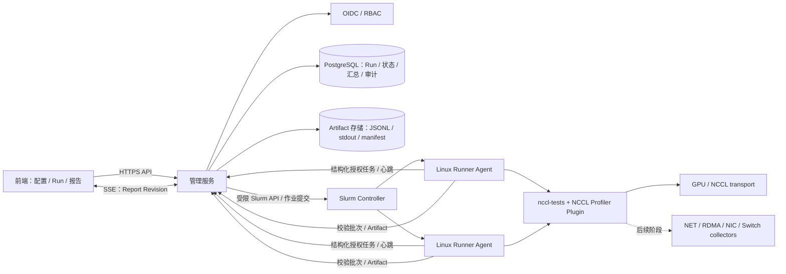

# NCCL Tests 前端运行与可观测报告端到端方案

状态：设计已由用户逐项确认，待分阶段实现  
更新日期：2026-11-17（Asia/Shanghai）

## 1. 目标与现状

目标是让用户从前端配置并启动 nccl-tests，按所选报告维度采集可证明来源的数据，并在运行期间看到真实增量。当前 `prototype-nccl/index.html` 是单文件前端原型：配置预览、运行过程和报告刷新均为浏览器内模拟，没有真实执行 API、Runner Agent、数据库、事件上传或 SSE。本文描述目标方案，不代表这些后端能力已经实现。

当前设计采用 Proxy-first 的采集推进顺序。第一批细粒度数据由与运行时 ABI 兼容的 NCCL Profiler Plugin 提供；RDMA/QP、Flow、NIC/交换机数据需要各自的网络和设备侧证据。不得用样例、chunkSize、rank/peer 或 nccl-tests 的 busbw 冒充网络测量。

## 2. 已确认的产品决策

- 用户在前端配置测试和报告维度；系统将维度解析为所需的工具链、采集器与事件类别。
- nccl-tests 原生 benchmark 是必需项；用户选中的报告维度默认必需，可显式设为可选。
- 每个报告维度独立成页，采用上方图表、下方完整宽表格；页面筛选、汇总、表格和导出采用相同过滤条件。
- 首发运行节点为 Linux GPU Runner；管理服务部署于内网 Linux，可与 Runner 同机试用。首发 Runner 支持 Ubuntu 22.04/24.04 x86_64。
- 多节点首发使用 Slurm：管理服务通过专用受限账号提交受控作业，Slurm 分配节点后由 `srun` 启动 ranks。无 Slurm 环境首发只支持单节点。
- nccl-tests、NCCL、MPI/PMIx、Profiler 插件使用管理员登记并验证的 Toolchain Profile；前端不上传二进制、不传任意 shell、不编辑任意 launcher 或 Slurm 脚本。
- Run 具有不可变 Configuration Snapshot、唯一 `run_id` 和独立 artifact；浏览器关闭不影响执行。重试总是新建 Run。
- 原生结果和 Profiler 事件分别保存。原始事件经 Agent 批次上传，服务端校验并持久化后确认；Agent 只清理已确认内容。
- Live Report 通过 SSE 收到状态和聚合更新，目标延迟约 1 秒。nccl-tests 原生结果只在真实 Native Result Point 完成后更新，不插值当前测试点。
- 管理服务使用 OIDC/SSO；PostgreSQL 保存控制面元数据；文件/对象存储保存不可变 Run Artifact。首发单管理服务实例，配套备份恢复。
- OIDC/SSO 为首选；没有 OIDC 的隔离部署由管理员配置本地认证，不维护与 SSO 并行的独立密码库。
- 开发阶段使用有审计的开发管理员授权，便于调整 Run 配置、执行环境 fixture 和采集设置；该授权由部署/身份策略提供，不硬编码在前端或绕过服务端鉴权。运行操作员与只读角色从实现初期就纳入权限模型和自动化验收，交付时通过身份/角色配置撤销开发账号的管理权限，不临时改业务代码。
- 普通应用队列按提交顺序 FIFO；单 Runner 同时一个任务；Slurm 完整 allocation 的等待期限默认 5 分钟。多 Run Analysis Plan 顺序执行。
- 数据缺失为 null 并带原因；测得的零、派生值、样例回放、未采集、不适用、失败、部分和推断关联使用不同状态。

## 3. 目标架构



管理服务是控制面，不 SSH 登录 GPU 节点。Runner 主动建立 TLS 控制连接；控制消息与事件/artifact 上传分开。Slurm account、partition、QOS、作业模板、允许节点组和资源上限由管理员登记。Runner 仅执行结构化 argv 和白名单环境变量。

### 组件职责

| 组件 | 职责 | 不负责 |
|---|---|---|
| Web 前端 | 配置 Run/Analysis Plan，查看预检、状态和报告，订阅 SSE，授权下载 artifact | 执行 shell、保存节点凭据、直接采集 GPU/网络数据 |
| 管理服务 | OIDC/RBAC、schema 与授权校验、Run 状态机、FIFO/Slurm 调度、配置快照、事件接收、报告查询与 SSE | NCCL 高频回调、直接 SSH 节点、虚构缺失数据 |
| Runner Agent | 能力/占用预检、领取授权 Run、落盘、启动/监控进程、事件 spool、重试上传、artifact 校验 | 用户身份认证、任意脚本执行、擅自更改 Run 配置 |
| Profiler Plugin | 目标 ABI 回调，复制事件到有界队列，异步生成版本化事件文件 | 改变 NCCL transport、在回调同步联网或阻塞写盘 |
| Slurm | 资源分配、allocation 生命周期与 ranks 启动 | 报告语义、指标关联与采集完整性判定 |
| Report API | 按 Run/revision 查询状态、聚合、明细和 artifact 元信息 | 把 host/GPU 时钟未经校准合并为统一时间线 |

## 4. 前端配置与预检

### Run Configuration

普通用户可配置：

- 已授权 Node Group、节点数和管理员公布的执行配置。
- 测试程序、collective、数据大小扫描、datatype、reduction op、warmup、iterations、正确性检查。
- 逻辑 rank 布局：每节点进程数、每进程线程数、每线程 GPU 数及允许的 split 配置。
- 选择的 Collection Dimensions 和每项 required/optional。
- Toolchain Profile（仅管理员登记且该用户/节点组可用的组合）。
- 允许列表内的 NCCL 参数；所有未允许环境变量、任意路径、shell 文本均拒绝。

保存配置作为可编辑 Run Template。提交时服务端冻结 Configuration Snapshot；历史 Run 不随模板变化。基于历史 Run 重跑会创建新 Run 并展示配置差异。请求使用幂等键，避免网络重试/双击创建重复 Run。

### 三层预检

1. **前端**：字段、组合和范围的即时校验。
2. **管理服务**：OIDC 身份、RBAC、配置 schema、节点组、Toolchain Profile、required dimensions、Slurm 策略和资源上限校验。
3. **Runner**：实际 NCCL/Profiler ABI 与插件哈希、MPI/PMIx、GPU 可见性/型号/占用、rank 映射、磁盘/spool 配额、事件类别可用性、`-U` 冲突以及节点策略校验。

预检失败保留 `run_id`、Configuration Snapshot 和 Preflight Result，但不创建空性能行。Required Dimension 不可用时阻止启动；optional 维度不可用时可继续，并明确标记原因。选择的维度自动解析为 Collector Dependencies；共享 Profiler 只初始化一次。Flows/QPairs/Ports 首发仅展示能力说明，不能被选成“会采到”的必需维度。

## 5. Run 生命周期、Slurm 与取消

```text
Queued → Preflight → Reserving → Starting → Running → Finalizing
  └──────────────终态：Succeeded / Partial / Failed / Cancelled
```

`Runner Disconnected` 是连接子状态，不等于 Run 终态。超过管理员设置的失联宽限期进入 `Pending Verification`；没有进程退出证据时不伪报失败。后续 Agent 补报或管理员核验通过 Evidence Revision 留下旧/新结论、理由、操作者与时间。

- FIFO 只约束管理服务自己的待提交队列；Slurm partition/account 的站点优先级仍由 Slurm 管理。
- 从进入调度起等待完整 Slurm Allocation 最多 5 分钟；到期取消 pending job，不在部分节点启动。
- 管理服务提交受控 job；Slurm 分配后 Agent 准备所有目标节点。所有节点 ready 后协调下发启动 gate，由 `srun` 使用登记的 MPI/PMIx 组合启动 ranks。记录各节点实际进程启动时间和误差，不宣称纳秒同步。
- 预检验证 requested rank layout 与 allocation 的 GPU、CPU、节点资源一致，生成不可变 Rank Mapping。
- 同一 Runner 同时执行一个 Run。跨节点作业须整体分配；不能只在部分节点运行。
- 用户有权限的取消请求先向进程组发送可处理终止信号，等待 10 秒；超时通过 Slurm 终止 allocation。保存已产出数据，终态 `Cancelled`。
- 管理服务/浏览器断连不自动停止当前 Run。Agent 本地 spool 并在恢复后补传；断连时不收新 Run。
- Analysis Plan 的子 Run 顺序执行；失败后继续未运行项，除非取消整个计划。失败点重试创建新 Run，保留旧结果与计划历史。

### 终态判定

- 用户取消：`Cancelled`，可以含已完成 benchmark 和部分 evidence。
- 非取消退出且无有效 native benchmark 结果：`Failed`。
- 有有效 benchmark，但 required collection/source 不完整、丢失或失败：`Partial`。
- benchmark 正常结束且所有 required evidence 完整：`Succeeded`。
- Analysis Plan 单独汇总成功/失败/缺失对比点；不完整计划不标为成功。

## 6. 维度、来源与实施方案

| 页面/维度 | 首发来源与字段 | 当前 nccl-tests 单独可得？ | 实施方式/边界 |
|---|---|---:|---|
| Summary / Performance | 原生 stdout/JSON：size、count、type、op、time、algbw、busbw、wrong 等 | 是 | Runner 解析已完成 Native Result Point，并保留原始输出。时间单位依实际版本 schema；本地核验实现输出微秒。busbw 是公式派生，不是 NIC 计数。 |
| Stability / Details / Iterations | 原生 benchmark 参数和原生输出中实际提供的数据 | 部分 | 不把 `-m` 聚合计时拆成多个单次观测；原生输出未给的逐 iteration/尾延迟数据保持缺失。 |
| Chunks | Profiler Collective、ProxyOp、ProxyStep 和状态事件；`rank/comm/channel/peer/direction/declared_n_steps/declared_chunk_size/observed_steps` | 否 | 开发 ABI 兼容的 Profiler Plugin；页面首发标注 **Proxy-step view**。`nSteps`、捕获 step 数、RDMA request 数分列；chunkSize 不推算 payload。 |
| Timeline | Collective start/stop、ProxyOp/ProxyStep 状态、Kernel Channel | 否 | 插件记录事件 handle/parent、原始时间与 clock domain；无校准时按 host/rank/时钟域分 lane，不算跨域 duration/overlap。 |
| NCCL Logical Communication Edge | Profiler 的 communicator-scoped `rank + peer + isSend + channel` | Proxy 可给逻辑关系 | 显示 NCCL 软件逻辑边；这不证明物理网络连接或发送接收已匹配。 |
| Flows | 后续：逻辑边与经网络连接/packet 证据得到的 Network Flow 并列 | 否 | 不能从 Proxy peer 伪造 5-tuple。先复用目标 NCCL 构建支持的 NetPlugin/IB profiler 事件；研究过的上游 IB profiling 受 `NET_PROFILER` 编译选项控制（固定提交默认关闭），仅设置环境变量不足以启用。必须验证运行库构建、事件 ABI 和 parent 关联。Flow Size 先定义为选定 Flow 下去重的 transport request/WR 长度总和，并明确 Flow 生命周期/方向；缺失连接/QP 字段时再做窄范围连接生命周期插桩或受控外部网络采集。 |
| QPairs | 后续：QP create/connect/close、host/HCA/QPN/generation、实际 request/WR length/opcode/status；可选单 QP 硬件 counter | 否 | Profiler/NET 事件可能提供局部 QP/request 字段，但要补连接元数据及生命周期。Linux RDMA per-QP counter 取决于 NIC/driver/firmware/权限；记录 counter 成员与 scope。QPN 必须限定 host/device/lifecycle，不强制 ProxyStep↔WR 一对一。 |
| Ports | 后续：HCA physical port、netdev/PCI/GUID 映射及端口硬件计数器/采样窗口 | 否 | 用 RDMA/ethtool/厂商遥测适配器读取真实 counter。保留 PF/VF/vport/physical scope、方向、采样起止和 reset。端口聚合不能按 rank/QP 拆分。 |
| RDMA Request Payload Length | 后续：网络插件/verbs/HCA 实际观测的单 request/WR length | 否 | 每条 request 保存方向、length、opcode、状态和来源。与 collective logical size、NCCL chunkSize、Ethernet packet/wire bytes 独立。 |
| PFC/ECN/CNP/CRC/拥塞诊断 | 后续：目标设备/交换机支持的原始计数和配置 | 否 | 按设备真实能力显示；无源、无权限、计数器不支持、采集失败各有状态。不能由 QP/RDMA 字节反推拥塞根因。 |

NCCL Profiler Plugin、NCCL Network Plugin 和内部 Proxy 是不同概念：Profiler Plugin 观察事件；Network Plugin 承载传输接口；内部 Proxy 推进部分传输工作。阶段一不替换 NCCL 网络传输，也不假定仅设置 `NCCL_PROFILER_PLUGIN` 就一定能得到所有 ABI 事件。

### Profiler Plugin 首阶段实施

1. 为每个通过准入的 NCCL Profiler ABI 构建/适配 versioned plugin package。回调实现 `init/startEvent/recordEventState/stopEvent/finalize`；事件掩码按该 ABI 头文件定义，不跨版本复用位值。
2. 请求并验证 Collective/P2P 上下文、ProxyOp、ProxyStep、Kernel Channel；支持情况由兼容矩阵逐事件记录。每个 rank 都必须证明加载插件并报告实际收到的事件类型。
3. 在 callback 中只读描述符、复制字段到有界内存队列；后台异步追加 versioned JSONL。禁止同步网络调用和慢速持久化回调。
4. 保存 `run_id/host/host_boot_id/pid/pid_start/rank/comm_key/event_id/parent_event_id/type/ABI/plugin/schema/source_clock/source_timestamp/receive_timestamp/validity`。指针只在进程内转换为稳定 ID，不直接跨进程关联。
5. ProxyOp 保存 `declared_n_steps`、`declared_chunk_size_bytes`；ProxyStep index/state separately. 保存声明步数、观测事件数、丢失、重复、孤儿、缺 stop、时间倒退等质量计数。
6. `Kernel Channel.pTimer` 与 host callback timestamp 属于不同 clock domain。仅在有校准方法和误差界时换算；没有校准不算跨域 overlap 或跨主机 latency。
7. 精确 iteration 关联优先用经验证的 userTag/显式上下文；没有则保留 communicator 序号或 inferred。不得把 `agg_iters` 的平均 `times_us` 拆为 ProxyStep 时长。
8. 启动预检检查 nccl-tests `-U` 与插件加载路径冲突，阻止静默覆盖；不得声称静态和自定义 profiler 同时成功工作。

### 无 GPU ABI 测试宿主

在真实 GPU smoke test 之前，为每个目标 Profiler ABI 提供 Linux ABI 测试宿主（`profiler-abi-host`）。它通过 `dlopen` 加载待测 plugin package，解析对应 ABI 的 versioned profiler entry symbol，按 ABI 头文件定义调用插件回调；测试宿主不得自行复制/猜测 NCCL 结构体布局。宿主接受版本化测试场景，构造该 ABI 的合成描述符并驱动完整生命周期：

```text
load plugin → init / request event mask
  → startEvent(Collective / ProxyOp / ProxyStep / KernelCh)
  → recordEventState(支持的状态序列)
  → stopEvent
  → finalize / flush
  → validate JSONL and quality summary
```

合成场景至少覆盖：

- 所请求事件掩码与插件声明能力一致；不支持的事件类型明确返回/记录，而非伪造零事件。
- Collective → ProxyOp → ProxyStep 的 parent/handle 关联，及没有 parent、孤儿和跨 communicator 相同 rank 的隔离。
- ProxyOp `nSteps/chunkSize/isSend/peer/channel`、ProxyStep 序号和状态转换的字段解析；声明步数与观察事件数分开。
- 缺省字段、未知可选字段、未知 state、重复/乱序 state、缺少 stop、重复 handle、时间倒退和 finalize 时未闭合事件。
- callback timestamp/clock domain 原样保留；GPU timer 不伪装成 host 时间；无校准时不生成跨域 duration。
- 有界队列满、异步 writer 错误、磁盘写失败和 finalize 刷盘；事件丢失计数可见，插件回调不因测试宿主而同步联网。
- 同一场景多次运行输出满足 schema，事件 ID 唯一，父子 ID 可解析；运行 sanitizer/泄漏检查，插件卸载和资源清理无错误。

测试宿主产生的是 `SAMPLE REPLAY`/合成 ABI 事件，不是 NCCL 事件。它能证明 plugin 对给定 ABI 结构、回调生命周期、字段映射、队列、序列化和清理逻辑的行为；**不能证明真实 NCCL 会加载此 plugin、实际触发 Proxy 事件、该构建包含 NetPlugin profiling，或 GPU/RDMA 数据正确**。通过宿主测试后仍需目标 NCCL/GPU 每 rank plugin smoke test 才能把兼容组合发布为实机验证通过。测试宿主不应将合成场景混进产品采集报告或硬件兼容性成功记录。

### 维度状态契约

每个指标及每行事件提供 `source`、`collection_state`、`scope`、`unit`、计算口径/公式版本、源事件/Artifact 引用。状态至少区分：真实观测、派生、推断关联、SAMPLE REPLAY、未采集、不适用、采集失败、Partial。缺失用 null+reason；数值 0 只能表示该来源明确测得 0。unknown schema major 标记不可解析，原始证据仍保留。

## 7. 数据流、实时报告与事件契约

### 运行数据流

1. UI 通过带幂等键的 API 提交结构化配置。服务端授权、冻结 Snapshot、创建 `run_id` 和 revision。
2. 管理服务执行 schema/策略检查，再通过受限 Slurm 集成提交 job。
3. Runner 完成运行时预检，核验工具版本、设备、GPU占用、ABI事件能力、磁盘和配置冲突；required 项通过后才启动。
4. nccl-tests stdout/stderr 流入受限日志采集器；每个完成的 native result point 立即保存/上报。JSON 输出文件在测试结束后仍作为原始 Artifact。
5. Profiler callback 事件进入每进程有界队列，异步 JSONL spool。Agent 按约 500ms 形成事件批次；附批次序号、event ID、schema version、文件偏移/范围和 SHA-256。
6. 服务端校验哈希、大小、序号和 schema，持久化后回 Artifact Receipt。相同 Run/event ID 幂等去重；保留 source order、source time、agent receive time、server receive time，不因重传改写源顺序。
7. 报告查询服务更新聚合和 Report Revision，SSE 推送运行状态、完成点数、数据质量和报告摘要。明细分页读取，原始高频事件不逐条推到浏览器。
8. 浏览器断开后以最后 Report Revision 重连；服务端能补齐则发增量，不能补齐则返回完整 snapshot。Artifact 下载走授权 API，不走 SSE。

### 事件示例（字段示意，须按具体 ABI/schema）

```json
{
  "schema_version": "1.0",
  "run_id": "run_...",
  "event_id": "hostboot-pid-seq",
  "parent_event_id": null,
  "source": "nccl_profiler",
  "source_event_type": "proxy_op",
  "rank": 3,
  "communicator_key": "comm_...",
  "channel_id": 2,
  "peer": 1,
  "is_send": true,
  "declared_n_steps": 4,
  "declared_chunk_size_bytes": 1048576,
  "source_clock_domain": "host_monotonic",
  "source_timestamp_ns": 123456789,
  "received_at_utc": "2026-11-17T00:00:00Z",
  "validity": {"peer": "valid", "parent": "not_provided"}
}
```

示例不是 ABI 定义；`declared_chunk_size_bytes` 不表示每个实际 ProxyStep 的 payload。

### 实时语义

- 状态、Runner 心跳、日志尾部、事件质量和报告聚合约 1 秒内刷新为目标。
- nccl-tests 原生报告只在一个真实配置点完成时新增 Native Result Point。当前点显示运行中，不产生预计值/插值。
- 进度只显示已完成点数/计划点数、Analysis Plan 已完成子 Run 数和当前项，不估算剩余时间或中间百分比。
- Timeline 默认分 host/rank/clock domain。跨时钟域对齐必须记录 calibration 与误差界；不满足精度要求时隐藏跨域 duration/overlap。

## 8. 存储、安全与运维

### 身份和权限

- 按管理员、运行操作员、只读报告用户授权。OIDC/SSO 为首选；没有 OIDC 的隔离部署使用由管理员配置的本地认证。
- 开发与联调环境可将受控开发账号授予管理员角色，以最大权限调整配置、节点/工具链 fixture 和采集设置；所有操作仍经过服务端授权并写审计。不得实现全局鉴权 bypass、前端硬编码管理员标志或共享永久管理员凭据。
- 管理员/操作员/只读用户的授权规则及负向测试从首个可运行切片开始实现。交付前只调整部署的用户角色和资源授权：操作员可在管理员发布的执行环境/参数范围内提交和取消 Run，不能修改环境或策略；只读用户只能查看授权报告。权限降级必须通过测试，不把临时改代码留到最终交付阶段。
- 管理员维护 Runner、Toolchain/Profile package、Node Group、Slurm 策略、GPU 集合、资源上限、Profiler ABI 矩阵和 retention policy。
- 操作员运行/取消自己有权访问的 Run 与 Analysis Plan；只读用户只能查看已授权的报告。
- Runner 主动 TLS 控制连接，注册码首次登记、之后轮换凭据；服务端不保存 GPU 节点 SSH 密码。
- 所有 Run 操作、配置修改、插件升级、artifact 下载、人工修订进入审计记录。
- 原始 Profiler/诊断 artifact 下载仅管理员与该 Run 操作员可用；报告权限沿 Run 继承。配置和日志中的 token、密钥等脱敏，任意 secret 环境变量禁止注入。

### Runner 和插件运维

- 管理员定义允许 GPU、活跃进程策略、最大 wall-clock、GPU 数量、数据规模、spool 配额和失联宽限期。
- 插件包由管理员发布，记录版本、ABI、哈希与事件能力；升级前 drain Runner，原子切换，验证失败回滚。不得由用户上传任意 `.so`。
- 每个 NCCL/Profiler ABI/plugin 组合先通过 ABI 测试宿主的回调、字段、队列、序列化和清理测试；每个 NCCL/Profiler ABI/MPI/PMIx/plugin 运行组合还必须通过目标 NCCL/GPU plugin smoke test 后，才能发布为实机验证通过的兼容矩阵项。没有 GPU 时可以发布为 `ABI harness verified; runtime unverified`，不得宣称端到端采集兼容。未知 ABI 预检失败或对 optional dimension 明确不可用；不能显示“零事件”。
- Profiler、网络、设备采集会有测量开销。所有结果记录 Instrumentation Condition；有/无 profiler 的结果不可无条件混比。
- spool 满时丢弃新的 optional event 并记录丢失；required evidence 无法保留则中止。原生结果和 manifest 使用独立保护空间。

### 留存与恢复

| 数据 | 默认保留 |
|---|---:|
| 原始 Profiler JSONL、nccl-tests stdout/stderr、Runner 诊断日志 | 30 天 |
| 报告汇总、Run manifest、配置快照、审计/修订所需索引 | 1 年 |
| Agent 未确认 Runner Spool | 直到 Artifact Receipt；受配额约束 |

留存期限由管理员统一配置，用户可查看到期时间但不可延长。服务端存储 PostgreSQL 元数据和索引，artifact 先支持本地文件系统，提供 S3 兼容对象存储适配边界。PostgreSQL 每 15 分钟归档/备份，artifact 每日快照；目标 RPO 15 分钟、RTO 4 小时。首发单管理服务实例，不承诺 HA。

## 9. Analysis Plan 与可比性

Group Concurrency 和 Horizontal Scaling 由 Analysis Plan 生成多个子 Run。计划定义固定 Analysis Baseline（Toolchain、collective、datatype/op、校验、采集配置、placement 等）及显式变化项（例如并发度或 rank 数）。不符合基线的 Run 不纳入同一曲线。子 Run 顺序执行；失败后继续后续点，除非取消。计划结果显示失败/缺失点，不把不完整对比标为成功。

Profiler 开启/关闭是不同 Instrumentation Condition。若分析插桩开销，计划显式安排成对基线 Run，不将两者无条件合并统计。

## 10. 分阶段实施与验收

### 快速采集通路（先验证数据链）

先交付下面四个纵向切片。它们共享同一事件 schema、导入/查询边界和报告页面，逐步替换事件生产者：Mock 回放 → ABI 测试宿主/Profiler Plugin → 真实 NCCL/GPU。这样可在没有 GPU 时先看数据通路和报告，同时不把合成数据误认为真实测量。

| Ticket | What to build | Blocked by | 独立验收结果 |
|---|---|---|---|
| 01. 事件数据契约与本地报告通路 | 版本化 Run/Profiler 事件契约、来源/质量字段、fixture 导入和报告查询；连通 Chunks/Timeline 图表与表格 | 无 | 固定 fixture 可导入并在页面呈现；缺失/孤儿/未闭合状态可见，过滤/图表/表格/export 一致 |
| 02. Mock 回放与报告增量刷新 | Mock Producer 按批次回放事件，通过同一导入/查询接口更新报告；样例标识贯穿 UI 与导出 | 01 | 无 GPU 时能演示报告逐批刷新；所有合成结果均为 `SAMPLE REPLAY` |
| 03. ABI 插件与无 GPU 测试宿主 | ABI 兼容 Profiler Plugin、dlopen 测试宿主、合成回调场景、事件 JSONL 输出并导入同一报告链 | 01、02 | 能验证回调、字段映射、生命周期、异常路径、落盘和清理；结果标记合成 ABI 数据，状态为 runtime unverified |
| 04. 真实 NCCL/GPU smoke test | 用目标 NCCL/nccl-tests 加载插件并采集真实事件，经同一事件通路生成报告 | 03 | 逐 rank 加载证据、实际事件类别、finalize/文件完整性和报告行可核验；只有通过后才标为 runtime verified |

快速路径阶段先采用本地开发运行器/存储适配，不等待 OIDC、Slurm、多节点和生产级对象存储。接口按将来的 Management Service/Runner 边界设计；生产身份鉴权不能被全局绕过，开发管理员权限仍由部署角色授予。Mock、ABI 宿主和真实 NCCL 是不同 evidence source，报告和兼容矩阵必须分别标注。

### 产品化 backlog（快速采集通路之后）

| 阶段 | 交付 | 验收证据 |
|---|---|---|
| P1. 管理面与真实 Run | OIDC/RBAC、Run snapshot、开发管理员授权、Runner 注册/心跳、原生结果、SSE、审计 | 开发管理员/操作员/只读用户权限测试；从前端提交、运行、刷新、取消、重连完整验证 |
| P2. Slurm 多节点调度 | 受限 Slurm/srun、allocation、协调启动、rank mapping、FIFO 与 deadline | 多节点 allocation smoke；资源超时不部分启动，进程退出和取消可审计 |
| P3. Artifact 与恢复运维 | spool、幂等上传、Artifact Receipt、备份恢复、retention、失联核验和 Evidence Revision | 断连补传、哈希失败、配额耗尽、恢复及审计测试 |
| P4. Network / Flows / QPairs | 复用可用 NET/IB profiling；补连接生命周期；request/WR 和 QP identity；可用时接单 QP RDMA counters | 双 QP 隔离对照、request/QP 关系证据、计数器成员和 scope 核验；不把 QP 聚合计数标成 per-QP |
| P5. NIC / Switch Ports | 设备、物理端口、链路和计数器 adapter；PFC/ECN/CNP/CRC 等按设备能力提供 | 硬件计数前后快照、reset/共享流量/权限负例；指标与源 counter 语义逐项对应 |
| P6. 跨层关联与诊断 | logical edge / network flow / request / QP / port 多对多关联；时钟不确定度与证据等级 | controlled topology/workload 对照，字段完整率、关联率、丢失率和校准误差可审计；证据不足时输出 Insufficient Data，不诊断根因 |

没有真实 GPU/RDMA 环境时，可以完成 schema、fixture、管理面和单机 Runner 开发，但不能把 plugin/WR/QP/Port 能力标为硬件验收通过。多节点发布必须有实际 Slurm allocation 和多节点 smoke 证据。

## 11. 关键验收测试

- 前端提交相同幂等键只创建一个 Run；显式重跑产生新 Run，配置快照不可变。
- 开发管理员可管理和调试配置；运行操作员可在授权环境内提交/取消但不能改管理员策略；只读用户不能修改配置或启动/取消 Run。三种角色均由服务端鉴权测试覆盖；交付角色切换不需修改业务代码。
- 前端/服务端/Runner 三层拒绝超范围参数、未授权节点组、未知 ABI、缺失 required collector 和 `-U` 冲突。
- Slurm 资源等待 5 分钟超时不启动部分节点；rank layout 与实际 allocation 一致。
- stdout 测试点完成后刷新；未完成点无虚构 latency；SSE 断线通过 revision 增量或快照恢复。
- 插件事件 fixture 验证父子关联、字段缺失、重复/乱序、孤儿、event loss、无 stop、host/GPU 时钟域、Filter/Table/Chart/Export 一致。
- 无 GPU ABI 测试宿主按目标 versioned header 加载 plugin 并驱动回调，验证事件 mask、字段/parent 映射、完整生命周期、异常路径、异步落盘、丢失计数和卸载清理；输出明确标记合成数据，不能代替真实 NCCL/GPU smoke test。
- JSONL/artifact 上传重试按 ID 幂等；哈希/大小不符不返回 receipt；服务端确认前 Agent 不删除 spool。
- optional collector 失败保留 benchmark 并标 Partial/Collection Failed；required collector 失效按规则终止或判 Partial；取消 10 秒后走 Slurm kill 并保留 evidence。
- Flows/QPairs/Ports 无源时不产生 0 或虚拟网络值；chunkSize、logical size、request payload、packet、wire bytes 字段互不替代。
- Runner 失联、恢复补传、管理员核验和 Evidence Revision 均有审计；权限用户不可读取未授权原始 artifact。
- Analysis Plan 对不符合 baseline 的 Run 排除并显示原因；失败点保留，顺序执行后续点。

## 12. 证据与边界

- 当前原型实现状态：单 HTML，无后端 API/Runner/实时传输；见 [原型交接说明](../nccl-prototype-handoff-20261110.md)。
- nccl-tests 调用链、计时和输出语义见 [源码学习指南](../nccl-tests-code-learning-guide.md)；本地源码没有 Git 元数据，不能由目录名断言官方版本。
- NCCL 核心执行路径静态参考固定提交见 [核心架构笔记](../nccl-core-architecture-research-notes.md)。
- Proxy Plugin 回调、事件、报告约束见 [Proxy-first 规格](../nccl-observability-proxy-first-spec.md)。
- Flow/QP/Port/NET/RDMA 能力和 Linux RDMA counter 条件见 [增强指标采集研究](../nccl-enhanced-metrics-acquisition-research-20261111.md)。该研究没有连接真实 GPU/RDMA 环境；所有硬件能力仍需按目标运行栈做 smoke test。
- 本文不声称已实现、已部署、已编译 NCCL plugin 或测得 profiler overhead/硬件指标。

## 13. 报告页面与演示数据

- Summary、Performance、Stability、Details、Iterations、Chunks、Timeline、Group Concurrency、Horizontal Scaling 各自使用独立页面/维度；同一页面上方展示图表，下方展示可核查的完整宽表格。
- Chunks 页明确标注为 `Proxy-step view`，不暗示与第三方工具私有 Chunk 语义等价。
- Flows、QPairs、Ports 保留页面入口，显示需要的后续来源与能力状态；首发无真实来源时显示 `Not collected`、`Not applicable`、`Collection failed` 或 `SAMPLE REPLAY`，不能显示为实测零值。
- 样例数据只能处于显式 `SAMPLE REPLAY` 状态；导出内容也保留来源/状态标签。
- 每页筛选条件一致作用于图表、表格、汇总和导出。高频事件/完整日志作为受权限控制的独立 artifact 下载，不通过 SSE 承载。
